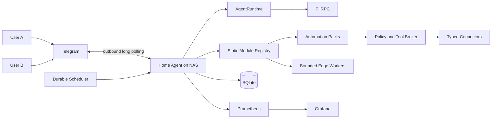

# Home Agent Platform

A private, production-like home agent for two explicitly authorized users. The
system uses Telegram as its first interface, runs on a NAS, integrates
personal and home services through least-privilege adapters, and treats
identity, authorization, scheduling, observability, and failure recovery as
first-class product concerns.

This repository defines a private personal-automation platform: home operations,
personal briefings, job applications, mentoring, and future workflows share one
secure control plane without sharing unrestricted authority. Architecture and
an isolated runtime experiment are complete. The initial Go scaffold provides
configuration, module lifecycle/dependency validation, JSON logging, graceful
shutdown, and local health endpoints. Feature implementation has not started.

## Current direction

- Go modular monolith on the NAS
- Statically compiled modules enabled through configuration; no dynamic Go
  plugin loading initially
- Reusable connectors, domain automation packs, and device-specific edge workers
- Core-owned durable workflows, policy, approvals, audit, and notification outbox
- Telegram Bot API using outbound long polling
- Replaceable `AgentRuntime`, with Pi RPC as the first runtime candidate
- SQLite for principals, sessions, schedules, approvals, audit, and outbox state
- Direct service APIs by default; MCP only where it provides concrete value
- Read-only integrations first
- Durable scheduled workflows for briefings and notifications
- Grafana and Prometheus locally; heavier logging/tracing components only when
  justified
- No public NAS endpoints
- Home Assistant, RAG, local inference, and multi-agent orchestration deferred

## Documentation map

| Document | Purpose |
| --- | --- |
| [Vision and principles](docs/01-vision-and-principles.md) | Product intent, users, outcomes, principles, and non-goals |
| [Scope and capabilities](docs/02-scope-and-capabilities.md) | Capability inventory, access modes, phases, and example interactions |
| [System architecture](docs/03-system-architecture.md) | Components, runtime boundary, request flows, and data model |
| [Integrations](docs/04-integrations.md) | Telegram, Pi, Immich, NAS, UniFi, Google, Notion, and GitHub |
| [Security and privacy](docs/05-security-and-privacy.md) | Trust boundaries, credentials, policy, approvals, audit, and threats |
| [Scheduling and notifications](docs/06-scheduling-and-notifications.md) | Durable jobs, retries, deduplication, urgent email, and briefings |
| [Deployment and network](docs/07-deployment-and-network.md) | NAS sizing, UniFi topology, containers, storage, and remote access |
| [Observability and operations](docs/08-observability-and-operations.md) | Metrics, logs, alerts, dashboards, retention, backup, and recovery |
| [Technology decisions](docs/09-technology-decisions.md) | Accepted, proposed, experimental, and deferred decisions |
| [Delivery roadmap](docs/10-delivery-roadmap.md) | Incremental implementation stages and acceptance criteria |
| [Risks and open questions](docs/11-risks-and-open-questions.md) | Risk register, decision triggers, and unresolved product choices |
| [Module and automation model](docs/12-module-and-automation-model.md) | Static modules, connectors, automation packs, edge workers, workflows, and migration |
| [Pi subscription from Go](docs/research/pi-openai-subscription-from-go.md) | Reproducible validation of Go → Pi RPC → ChatGPT subscription |

The original input is preserved in
[home_agent_platform_brief.docx](home_agent_platform_brief.docx).

## Development scaffold

The root Go module targets Go `1.27.0` and pins `modernc.org/sqlite` as its
pure-Go SQLite driver. Run it locally with:

```sh
go run ./cmd/home-agent
```

The service binds to `127.0.0.1:8080` by default:

```sh
curl http://127.0.0.1:8080/healthz
curl http://127.0.0.1:8080/readyz
```

`HOME_AGENT_LISTEN_ADDRESS` changes the address and
`HOME_AGENT_SHUTDOWN_TIMEOUT` changes the graceful-shutdown deadline. A
non-loopback address is rejected unless `HOME_AGENT_ALLOW_NON_LOOPBACK=true` is
also set deliberately. `HOME_AGENT_DATA_DIR` selects the application-state
directory and defaults to `./data`; the service creates it with mode `0700` and
keeps the database at `0600`. An existing data directory must already be mode
`0700` and live below operator-controlled parent directories.

## Architecture at a glance



## Status

Documentation is the source of truth for the proposed system. The module and
automation model is accepted architecture. Its versioned descriptor,
dependency-ordering, lifecycle, and readiness slice is implemented; connectors,
automation packs, durable workflows, and contribution registration are not.
Decisions marked
`experimental` or `proposed` must be validated before they become product
dependencies. The Go -> Pi RPC -> ChatGPT subscription path passed two local
end-to-end checks and is accepted for the prototype. Credential refresh,
resource use on the NAS, Pi upgrade compatibility, and multi-user suitability
remain production-readiness questions.
