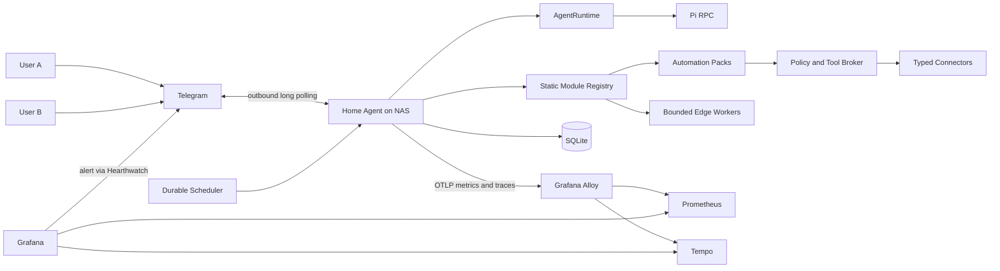

# Home Agent Platform

A private, production-like home agent for two explicitly authorized users. The
system uses Telegram as its first interface, runs on a NAS, integrates
personal and home services through least-privilege adapters, and treats
identity, authorization, scheduling, observability, and failure recovery as
first-class product concerns.

This repository defines a private personal-automation platform: home operations,
personal briefings, job applications, mentoring, and future workflows share one
secure control plane without sharing unrestricted authority. Architecture and
an isolated runtime experiment are complete. The initial Go scaffold provides
configuration, module lifecycle/dependency validation, JSON logging, graceful
shutdown, local health endpoints, and an opt-in Telegram access slice.

## Current direction

- Go modular monolith on the NAS
- Statically compiled modules enabled through configuration; no dynamic Go
  plugin loading initially
- Reusable connectors, domain automation packs, and device-specific edge workers
- Core-owned durable workflows, policy, approvals, audit, and notification outbox
- Telegram Bot API using outbound long polling
- Replaceable `AgentRuntime`, with Pi RPC as the first runtime candidate
- SQLite for principals, sessions, schedules, approvals, audit, and outbox state
- Direct service APIs by default; MCP only where it provides concrete value
- Read-only integrations first
- Durable scheduled workflows for briefings and notifications
- OpenTelemetry metrics and traces exported through Grafana Alloy to
  Prometheus and Tempo, with Grafana as the local query, dashboard, and alert
  interface
- Structured stdout logs with bounded container rotation; Loki deferred until
  local log search justifies its resource and access cost
- Private GitHub repository and CI-built immutable `linux/amd64` images in
  private GHCR; production deployment remains an explicit operation from the
  operator's Mac
- macOS Keychain as the canonical runtime-secret store, with only the required
  protected runtime copies on the NAS
- No public NAS endpoints
- Home Assistant, RAG, local inference, and multi-agent orchestration deferred

## Documentation map

| Document | Purpose |
| --- | --- |
| [Vision and principles](docs/01-vision-and-principles.md) | Product intent, users, outcomes, principles, and non-goals |
| [Scope and capabilities](docs/02-scope-and-capabilities.md) | Capability inventory, access modes, phases, and example interactions |
| [System architecture](docs/03-system-architecture.md) | Components, runtime boundary, request flows, and data model |
| [Integrations](docs/04-integrations.md) | Telegram, Pi, Immich, NAS, UniFi, Google, Notion, and GitHub |
| [Security and privacy](docs/05-security-and-privacy.md) | Trust boundaries, credentials, policy, approvals, audit, and threats |
| [Scheduling and notifications](docs/06-scheduling-and-notifications.md) | Durable jobs, retries, deduplication, urgent email, and briefings |
| [Deployment and network](docs/07-deployment-and-network.md) | NAS sizing, UniFi topology, containers, storage, and remote access |
| [Observability and operations](docs/08-observability-and-operations.md) | Metrics, logs, alerts, dashboards, retention, backup, and recovery |
| [Technology decisions](docs/09-technology-decisions.md) | Accepted, proposed, experimental, and deferred decisions |
| [Delivery roadmap](docs/10-delivery-roadmap.md) | Incremental implementation stages and acceptance criteria |
| [Risks and open questions](docs/11-risks-and-open-questions.md) | Risk register, decision triggers, and unresolved product choices |
| [Module and automation model](docs/12-module-and-automation-model.md) | Static modules, connectors, automation packs, edge workers, workflows, and migration |
| [Operator runbook](docs/13-operator-runbook.md) | Telegram verification, SSH and NAS preparation, secrets, monitoring-first deployment, rollback, and recovery |
| [Pi subscription from Go](docs/research/pi-openai-subscription-from-go.md) | Reproducible validation of Go → Pi RPC → ChatGPT subscription |

The original input is preserved in
[home_agent_platform_brief.docx](home_agent_platform_brief.docx).

## Development scaffold

The root Go module targets Go `1.27.0` and pins `modernc.org/sqlite` as its
pure-Go SQLite driver. Run it locally with:

```sh
go run ./cmd/home-agent
```

The service binds to `127.0.0.1:8080` by default:

```sh
curl http://127.0.0.1:8080/healthz
curl http://127.0.0.1:8080/readyz
```

`HOME_AGENT_LISTEN_ADDRESS` changes the address and
`HOME_AGENT_SHUTDOWN_TIMEOUT` changes the graceful-shutdown deadline. A
non-loopback address is rejected unless `HOME_AGENT_ALLOW_NON_LOOPBACK=true` is
also set deliberately. `HOME_AGENT_DATA_DIR` selects the application-state
directory and defaults to `./data`; the service creates it with mode `0700` and
keeps the database at `0600`. An existing data directory must already be mode
`0700` and live below operator-controlled parent directories.

### Telegram local setup

Telegram is disabled unless `HOME_AGENT_TELEGRAM_ENABLED=true`. For local
development, copy the ignored environment template and fill in the Telegram
bot token and your numeric user ID as described in the
[operator runbook](docs/13-operator-runbook.md):

```sh
cp .env.example .env
chmod 600 .env
```

The application loads `.env` automatically when it starts from the repository
root. In GoLand, open `cmd/home-agent/main.go`, run the `main` package, and keep
the working directory set to the project root. The command-line equivalent is:

```sh
go run ./cmd/home-agent
```

The Telegram user ID is ordinary allowlist configuration, not a secret. For
production, the configuration interface also accepts explicit token and users
files so the token does not need to be placed in the container environment:

```sh
HOME_AGENT_TELEGRAM_ENABLED=true \
HOME_AGENT_TELEGRAM_BOT_TOKEN_FILE=/protected/path/telegram-bot-token \
HOME_AGENT_TELEGRAM_USERS_FILE=/protected/path/telegram-users.json \
go run ./cmd/home-agent
```

The token file must have no group or other permission bits (`0600` is suitable).
The users file must contain one or two positive numeric Telegram user IDs,
distinct principal IDs, and non-empty display names. User IDs and allowlist
configuration may be versioned; bot tokens must never be committed.

The default Telegram API base URL is the official HTTPS endpoint. For local
testing only, `HOME_AGENT_TELEGRAM_API_BASE_URL` may override it with an HTTP
loopback URL. `HOME_AGENT_TELEGRAM_POLL_TIMEOUT` defaults to 25 seconds and
accepts at most 50 seconds.

The default behavior is deliberately narrow: private chats only, a numeric
allowlist, deterministic `/status` and `/privacy` replies, and ignored ordinary
text. Optional local conversation routes ordinary text to a locked-down Pi
runtime while `/status`, `/privacy`, `/cancel`, and `/new` remain deterministic.
The service stores a durable polling cursor per bot and persists accepted
conversation work before advancing it, so restart does not silently lose an
accepted message or replay already committed updates. A turn interrupted by a
restart is not submitted to Pi again: the bot reports the interruption and the
next message starts a fresh session. See the official
[Telegram Bot API reference](https://core.telegram.org/bots/api) for the
underlying API. `Hearthkeeper` is the preferred display name for the main bot,
with an available BotFather username such as `HearthkeeperHomeBot`. A separate
send-only alert bot named `Hearthwatch` is recommended so Grafana alerts do not
depend on the application bot. Telegram usernames are globally allocated, so
the exact usernames must be checked with BotFather. The deterministic commands and
ordinary conversation have passed real local Telegram tests; NAS operation
still requires its own verification.

### Local model conversation

Natural-language conversation is opt-in and intended for local GoLand testing
in this slice. Install and authenticate Pi first, then add these values to the
ignored `.env` file:

```dotenv
HOME_AGENT_CONVERSATION_ENABLED=true
HOME_AGENT_PI_BINARY=pi
HOME_AGENT_PI_NODE_BINARY=
HOME_AGENT_PI_PROVIDER=openai-codex
HOME_AGENT_PI_MODEL=gpt-5.6-luna:low
HOME_AGENT_PI_VERSION=0.84.1
HOME_AGENT_CONVERSATION_TURN_TIMEOUT=2m
```

If GoLand cannot resolve the Node runtime used by Pi, set both binary variables
to their stable absolute paths. Pi session history is stored below
`data/pi-sessions/`, which is protected by the same local data-directory
boundary and ignored by Git. SQLite keeps session ownership and request state;
message and response bodies are cleared after delivery. Use `/new` to rotate to
a fresh session and `/cancel` to stop an in-progress response.

The runtime passes no tools, extensions, skills, templates, themes, project
context, or approval authority to Pi. Its environment contains only the home
directory needed to find Pi authentication, the executable directory, and an
explicit Pi telemetry opt-out, so the Telegram token is not inherited. This is
process-level minimization, not an OS sandbox: the pinned Pi package runs as
the local application user and remains a trusted dependency. The production
container intentionally does not contain Pi yet; NAS packaging, authentication
delivery, and resource measurement require a separate plan.

## Architecture at a glance



Grafana does not bundle Prometheus, Tempo, or another telemetry store. Each is a
separate service with its own persistence and retention policy. Grafana binds
to NAS loopback for initial operation and is reached through an SSH tunnel;
none of the observability services requires a public endpoint.

## Status

Documentation is the source of truth for the proposed system. The module and
automation model is accepted architecture. Its versioned descriptor,
dependency-ordering, lifecycle, and readiness slice is implemented; connectors,
automation packs, durable workflows, and contribution registration are not.
Decisions marked
`experimental` or `proposed` must be validated before they become product
dependencies. The Go -> Pi RPC -> ChatGPT subscription path passed two local
end-to-end checks and is accepted for the prototype. An opt-in local
conversation adapter and durable per-principal coordinator are implemented and
have passed a local Telegram check, with the remaining live gaps tracked in
plan 0005. Credential
refresh, resource use on the NAS, Pi upgrade compatibility, and multi-user
suitability remain production-readiness questions.
