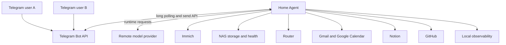
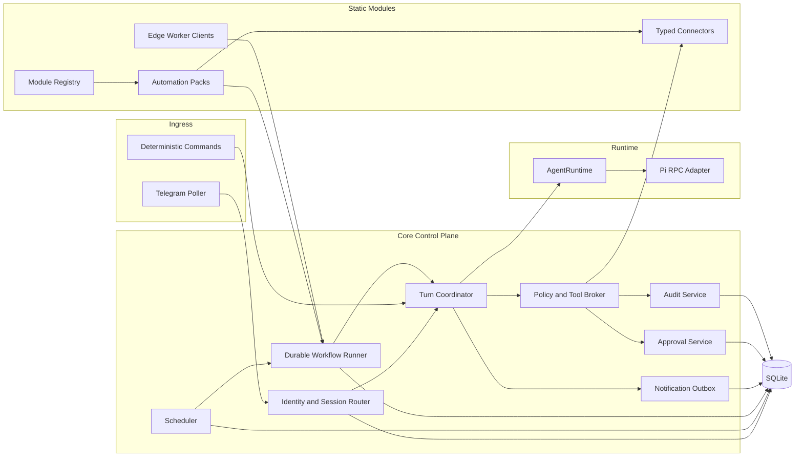
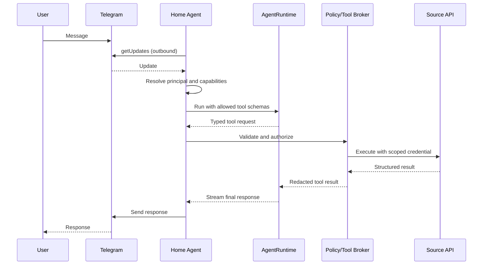
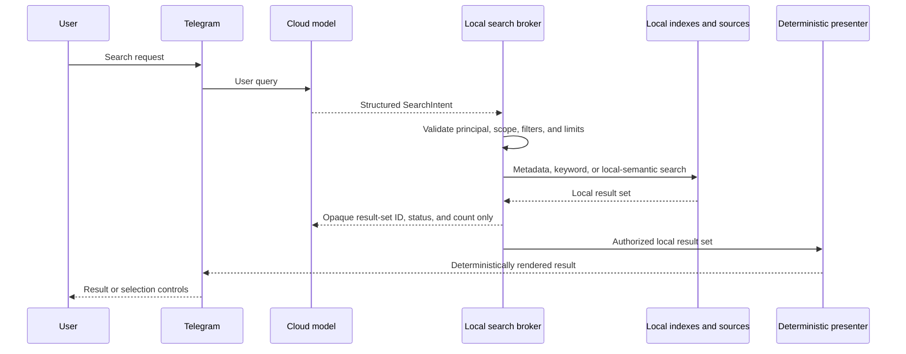
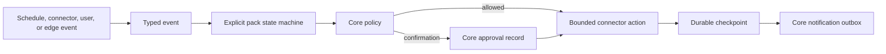
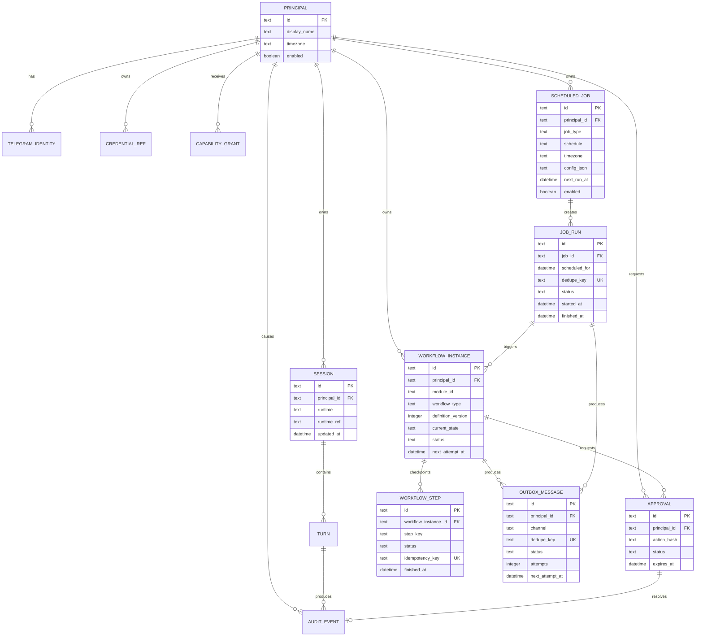

# System Architecture

## Architectural style

The system is a modular Go monolith deployed as one application service on the
NAS. Modules are statically compiled and registered at startup; configuration
enables them. The application owns the control plane and delegates
language-model turns to a replaceable runtime.

This shape keeps authorization and integration code in one trust boundary,
avoids network coordination between internal modules, and fits the expected
load of two users.

## System context



All cloud communication is initiated outbound. No integration requires a
publicly reachable NAS endpoint in the initial design.

## Component architecture



## Module responsibilities

| Module | Owns | Must not own |
| --- | --- | --- |
| Telegram ingress | Polling offset, parsing, outbound messages | User authorization decisions |
| Identity | Telegram ID → principal, grants, user settings | Model-generated identities |
| Session router | Runtime/session selection per principal | Cross-user session reuse |
| Turn coordinator | Request lifecycle, cancellation, timeouts | Integration credentials |
| Agent runtime | Model conversation, streaming, compaction | Tool policy or direct secrets |
| Tool broker | Tool registry, validation, policy, execution | Free-form model commands |
| Integration adapter | Concrete API and source-specific errors | Global authorization policy |
| Scheduler | Due work, leases, catch-up, job runs | Autonomous task invention |
| Outbox | Durable delivery and deduplication | Content generation policy |
| Approval service | Exact pending actions and confirmation state | Reinterpreting the action after approval |
| Audit service | Actor, capability, timing, outcome metadata | Sensitive payload logging by default |
| Module registry | Module descriptors, enablement, dependencies, contribution registration | Dynamic code loading or policy overrides |
| Connector | Typed access to one external source | Domain workflow rules or global authorization |
| Automation pack | Domain events, state machines, and renderers | Raw secrets, direct delivery, or unrestricted storage |
| Edge worker client | Authenticated device-specific request/event transport | Independent identity, approval, or scheduling policy |

The complete module contract, safety levels, and migration rules are defined in
[Module and automation model](12-module-and-automation-model.md).

## Module registration and contributions

Registration completes before Telegram ingress or scheduled execution starts.
Each statically linked module declares a stable identity, kind, dependencies,
configuration requirements, and contributions. Supported contributions include
typed tools, event sources, workflow definitions, scheduled-job types,
commands, health checks, metrics, deterministic renderers, and namespaced
migrations.

The registrar supplies narrow core interfaces. A module does not receive the
complete application, unrestricted SQLite access, raw secrets, or a direct path
to Pi. Dependency cycles fail startup; safely optional dependencies may instead
mark only the affected module degraded.

The current scaffold implements descriptor validation, dependency ordering,
lifecycle, and aggregated readiness. Contribution registration and optional
degraded dependencies are added with the first real connector; they are not
implied by the initial system module.

## Runtime boundary

The application-level contract is intentionally smaller than Pi or any model
SDK:

```go
type AgentRuntime interface {
	Run(ctx context.Context, request RunRequest, sink EventSink) (RunResult, error)
}

type RunRequest struct {
	PrincipalID string
	SessionID   string
	Message     string
	Tools       []ToolDefinition
	Metadata    map[string]string
}
```

The exact types will be refined during implementation. The invariant is that
Pi-specific event names, auth files, model IDs, and subprocess management do not
escape the runtime adapter.

## Interactive request flow



## Deterministic command path

Commands such as `/status`, `/cancel`, `/confirm`, and `/privacy` bypass the
model. This reduces latency, cost, and ambiguity for operations whose semantics
are already known.

## Strict-local search path

Strict-local is the default privacy mode for NAS files, photos, and other local
content. The cloud runtime may interpret the user request into a typed
`SearchIntent`, but it has no tool or capability for reading local content.



Raw files and photos, extracted text/OCR, embeddings, snippets, and preferably
filenames remain inside the NAS boundary. The model receives no search-result
content—only an opaque result-set reference, status, count, and truncation or
error state. It cannot follow the reference to open or summarize an item.

Presentation is a separate local path. It resolves the opaque result set,
applies principal and disclosure policy, and renders bounded results without
passing them back through the model. Delivering filenames, thumbnails, files,
or other metadata through Telegram is a separate disclosure to Telegram and
must be authorized and audited independently from model access.

Strict-local is not a zero-knowledge design: the cloud model sees the user query
and therefore may learn search terms and intent. Future modes may disclose one
explicitly selected file/photo or permit bounded document/photo content search,
but only through separate, scoped, auditable capabilities with explicit user
authorization.

## Scheduled request flow

A scheduled workflow uses the same policy and adapter path but does not pretend
to be an interactive Telegram message. It receives an explicit service context
containing the job owner, job type, schedule occurrence, and allowed tools.

The runtime is optional. For example, collecting due Notion tasks and formatting
a fixed alert needs no model; summarizing a multi-source morning briefing may use
one final model call.

## Event-driven workflow flow

Schedules are one trigger source. Connector polling, edge-worker completion,
and explicit user commands may also emit versioned, typed events. Events are
facts, not authorization.



Automation packs implement explicit Go state machines. The core persists the
workflow type and version, current state, trigger reference, retries,
idempotency key, pending approval, and result. No general workflow DSL or
external orchestration engine is planned initially.

## Tool contract

Each registered tool contains metadata similar to:

```text
name
description
version
input schema
output schema
risk class
credential scope
timeout
maximum result size
idempotency behaviour
audit fields
confirmation policy
```

The broker validates all arguments after model generation. Resource identifiers,
paths, URLs, and principal ownership are resolved again at execution time.

## Proposed package layout

```text
cmd/home-agent/
internal/app/
internal/core/
internal/module/
internal/telegram/
internal/identity/
internal/session/
internal/runtime/
internal/runtime/pi/
internal/policy/
internal/tools/
internal/search/
internal/presentation/
internal/approval/
internal/scheduler/
internal/workflow/
internal/outbox/
internal/audit/
internal/connectors/immich/
internal/connectors/nas/
internal/connectors/unifi/
internal/connectors/gmail/
internal/connectors/calendar/
internal/connectors/notion/
internal/connectors/github/
internal/features/jobapply/
internal/features/mentoring/
internal/features/briefing/
internal/edge/recording/
internal/observability/
internal/store/sqlite/
```

This is a direction, not scaffolding that must be created upfront. Packages are
added when a capability needs them.

## Logical data model



Sensitive credentials are not stored directly in general application tables.
`CREDENTIAL_REF` points to a protected credential backend or encrypted record.

## Concurrency and scale

The expected workload is small. One application instance is sufficient. It may
process independent reads concurrently but should serialize turns within one
session. SQLite transactions and job leases prevent duplicate scheduled work.

Microservices, Redis, Kafka, Kubernetes, and distributed consensus are outside
the justified complexity envelope.
