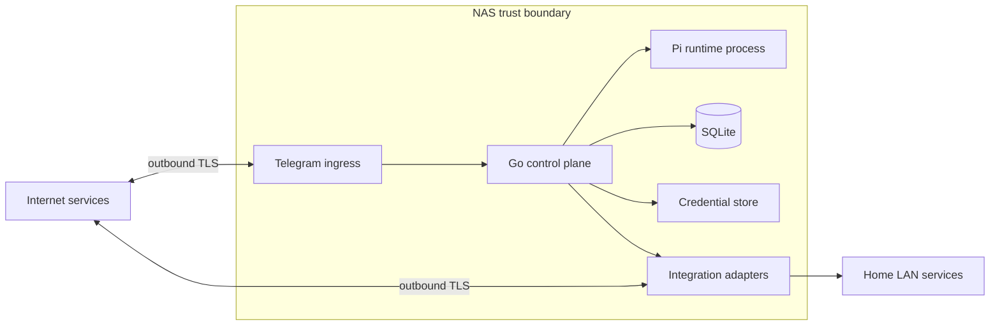
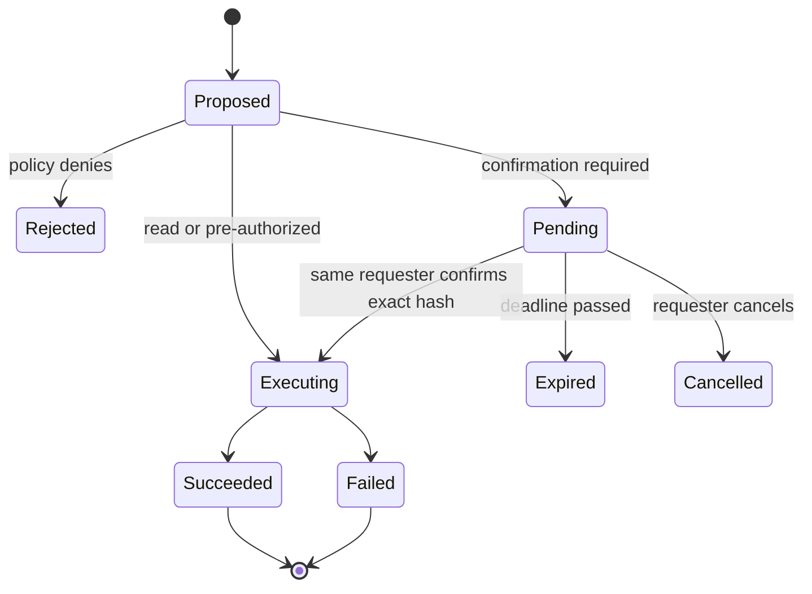

# Security and Privacy

## Security objectives

1. Unknown Telegram users cannot access capabilities or source data.
2. One authorized user cannot access another user’s personal integrations.
3. Model output cannot enlarge authority or select arbitrary credentials.
4. A compromised integration credential has the narrowest practical impact.
5. A failed or retried request cannot silently duplicate a consequential action.
6. Logs and traces remain useful without becoming a copy of private content.
7. No general-purpose administrative service is exposed to the public internet.
8. Local search content remains unavailable to the cloud model by default.

## Assets

- Telegram bot token and allowlist
- ChatGPT/Pi or API authentication state
- Gmail and Calendar OAuth refresh tokens
- Notion integration token
- GitHub App private key and installation tokens
- Immich and UniFi credentials
- NAS files and photos
- Conversation/session state
- Schedule definitions and notification preferences
- Audit records
- Network and device inventory

## Trust boundaries



Treat the model provider, Telegram, every external API, every source document,
and Pi output as untrusted input with respect to local authority.

The model-provider and Telegram boundaries are distinct. The provider sees the
user query sent for intent interpretation. Telegram sees messages and files
delivered through the bot. Preventing local content from reaching the model
does not prevent content explicitly sent through Telegram from reaching
Telegram infrastructure.

Third-party code runs inside the Pi process in one place: for a principal with
web access on, the vendored `pi-web-search` extension provides `web_search`.
It runs with the Pi process's own authority, which in the shared container is
the application's UID and therefore every principal's data directory, and with
the principal's model login through Pi's model registry. Its code sends search
requests only to the configured model provider, but nothing inside the process
enforces that, so the boundary is review: the source is vendored at a fixed
version in `third_party/pi-web-search/`, copied into the image rather than
installed from npm, and loaded only for principals whose web access is on,
which is everyone who has not turned it off while the operator enables it.
The larger `pi-web-access` package, which reads local paths, spawns
subprocesses, and sends queries to a third-party search service, was rejected
for that reason ([plan 0026](plans/0026-web-weather-and-pdf-tools.md)). Search
calls bypass the broker, so they have no broker audit line, untrusted-data
prefix, or call budget; the conversation logs each call by tool name without
content, and the turn's guidance tells the model that search results are data,
not instructions.

## Privacy modes for local content

### Strict-local mode

Strict-local is the default for NAS files, Immich photos, OCR, transcripts, and
other locally indexed content.

In this mode:

1. The cloud model receives the user query and may emit only a structured
   `SearchIntent` containing a source class, query, filters, and result limit.
2. The local broker validates the intent against the principal’s grants and
   configured roots or libraries.
3. Metadata search, keyword search, OCR, embedding generation, and semantic
   retrieval execute locally on the NAS.
4. Raw files/photos, extracted text, OCR, embeddings, snippets, and preferably
   filenames remain local.
5. The model receives only an opaque result-set ID, status, result count, and
   bounded error/truncation metadata. It receives no item content and has no
   content-reading tool.
6. A deterministic local presenter resolves the result set and renders the
   authorized response without another model call.

Opaque result-set IDs are short-lived, principal-bound, and non-enumerable. They
are not bearer authority: every resolve or selection operation rechecks the
principal and the source grant.

Strict-local describes the model boundary, not zero knowledge. The provider can
learn the original query and its search intent. The Telegram bot also receives
the user query before the model does.

### Telegram disclosure

Sending any result through Telegram is a separate disclosure decision. A local
presenter may produce counts, opaque numbered choices, filenames, metadata,
thumbnails, or an explicitly selected original depending on the principal’s
Telegram-delivery capability and source scope.

The default should omit filenames when a useful opaque label or bounded
metadata view is sufficient. Any filename, snippet, thumbnail, or original sent
through Telegram leaves the NAS even though it never passes through the cloud
model. The audit record captures the data class and source/result reference,
not the disclosed content itself.

### Future less-strict modes

Less-strict modes are disabled by default and are separate capabilities rather
than flags the model can set:

- **Selected-item disclosure** permits one explicitly selected file or photo to
  be sent to the model for one named operation and bounded turn.
- **Content-assisted search** permits bounded document/photo-derived content or
  snippets from an explicitly configured root, library, type, and time scope to
  be used by the model.

Both require explicit, scoped user authorization; current principal/resource
grants are rechecked at execution. Authorization records identify the mode,
source scope, item or query scope, purpose, expiry, model/provider, and result.
A natural-language model proposal alone cannot promote a strict-local request.
Raw embeddings and unrestricted source access remain local in every mode.

## Identity

The ingress pipeline resolves identity using the Telegram numeric `from.id` and
requires a private chat. It maps to an enabled principal before creating a turn.

Identity data passed to the runtime should be a non-secret principal reference
and relevant preferences. The runtime never receives credential values.

## Capability grants

A capability grant binds:

```text
principal
capability name and version
resource scope
credential reference
risk ceiling
optional conditions
enabled/disabled state
```

Examples:

- User A → `gmail.search` → User A mailbox → User A OAuth credential
- User A → `notion.search` → selected roots → User A Notion integration
- User B → no Notion capability
- Both users → `immich.search` → shared library → shared read credential
- User A only → `unifi.status` → controller → read-only UniFi credential

Tool availability is generated from these grants for every turn. The broker
rechecks the grant immediately before execution.

## Credential isolation

- Store credential material outside general configuration and audit tables.
- Use separate credential references per principal and provider.
- Mount Pi authentication state only into its runtime process/profile.
- Avoid copying tokens between Codex and Pi stores.
- Never place credentials in prompts, tool descriptions, errors, traces, or
  Telegram responses.
- Refresh OAuth tokens within the owning adapter or runtime profile.
- Define revocation and re-authentication procedures for every provider.

The initial credential backend may be a tightly permissioned local volume with
encrypted records. Selecting a concrete encryption/key-management mechanism is
an implementation decision that must consider what NAS OS supports reliably.

## Tool execution policy

The model returns a proposed tool name and structured arguments. The broker:

1. Looks up the registered tool version.
2. Validates input against its schema.
3. Resolves the principal’s capability grant.
4. Resolves resources such as path roots or repository IDs.
5. Applies risk and confirmation policy.
6. Loads the credential internally.
7. Executes with a deadline and result-size limit.
8. Redacts the result before returning it to the runtime.
9. Emits an audit record.

The model cannot supply a credential reference, filesystem root, API base URL,
or principal ID as an authoritative argument.

In strict-local mode, the model tool surface exposes only creation of a typed
`SearchIntent`. It does not expose file open/read, OCR retrieval, snippet
retrieval, photo preview, or result-set resolution. Search execution and result
presentation are local broker operations rather than model tool calls.

## Approval flow



An approval record stores a canonical action representation and hash. Confirmation
must come from the same principal before expiry. Policy and resource ownership
are rechecked after confirmation. The runtime cannot change arguments between
proposal and execution.

## Idempotency

Every write-capable tool defines its retry semantics:

- provider-supported idempotency key where available;
- local uniqueness key for create operations;
- read-before-write or reconciliation where safe;
- no automatic retry for ambiguous high-impact failures.

The scheduler and notification outbox also use occurrence/delivery deduplication
keys so restarts cannot repeat side effects.

## Filesystem safety

- Expose configured roots, not the entire NAS filesystem.
- Prefer read-only mounts.
- Resolve and normalize paths server-side.
- Reject `..`, absolute paths supplied as authority, symlink escapes, device
  files, sockets, and unsupported file types.
- Enforce file size and Telegram delivery limits before reading content.
- Stream files without retaining extra copies when possible.
- Keep local index data, OCR, embeddings, snippets, and result-set mappings in
  protected NAS storage; never include them in model-visible tool output.

PDFs from the chat, the NAS, or the web are untrusted files parsed in-process.
The parser is pure Go, so a malformed file cannot corrupt memory; the extractor
recovers from parser panics, stops after 100 pages or 512 KB of text, runs under
the tool call's deadline, reads at most 10 MiB, and refuses encrypted files it
cannot open. A pathological file can keep a parser goroutine busy after the
deadline, but the turn still ends on time.

## Prompt-injection resistance

Email, Notion pages, GitHub content, web pages, search results, filenames, and
photo metadata are untrusted data. They may contain instructions intended to manipulate the model.

Controls:

- clearly label tool results as data;
- expose only the next tools required for the user request;
- require application policy for every tool call;
- never reveal credentials or hidden policy to source content;
- limit recursion and tool-call counts;
- require confirmation for consequential actions regardless of model wording;
- prefer deterministic extraction for identifiers and permissions.

Email is the one source a stranger can write into at will. The Gmail
connector's credential is `gmail.readonly`, so even a fully successful injection
cannot send, change, or delete mail. Its guidance tells the model that message
content is never instructions, and the paths an injection could reach from
there are still bounded: Notion and NAS writes need the user's press, and a
file can only be sent to the owner's own chat.

## Network security

Initial deployment on Home VLAN is acceptable for a read-only prototype, but
the VLAN is the network’s admin segment and can initiate connections to all
other segments. A compromised agent container would therefore have broader
network reach than it needs.

Hardening options before adding write authority:

1. Give the agent container a distinct IP and apply source-specific UniFi rules.
2. Place service workloads on a dedicated Services VLAN.
3. Run the control plane in a constrained VM/network namespace.

No Docker socket, host PID namespace, privileged container, or broad filesystem
mount should be granted to the agent.

`fetch_page` and `weather_forecast` take addresses and place names from the
model, so every request they make goes through one guarded HTTP client that
refuses the home network. It allows only `http` and `https` on ports 80 and 443
without credentials in the URL, resolves the host itself, and refuses loopback,
private, link-local, CGNAT, multicast, unspecified, and IPv6 unique-local and
site-local addresses on every connection, including each of at most five
redirects, so DNS rebinding and a redirect to a `.home` name or the NAS both
fail. It sends no cookies, uses a fixed user agent, stops after 15 seconds, and
caps downloads at 2 MiB of text or 10 MiB for a PDF. Pages are fetched from the
home connection, so a site sees the household's public address.

## Logging and privacy

Safe default audit fields:

- request/turn/job ID;
- principal ID or pseudonymous stable reference;
- capability and integration name;
- policy decision;
- timing, attempt count, and outcome;
- provider request ID where safe;
- redacted error class;
- result size/count, not result content.

Do not log by default:

- Telegram message text;
- model prompts or full responses;
- email subjects/bodies or addresses;
- Notion/GitHub private content;
- NAS paths and filenames;
- photo metadata or thumbnails;
- tokens, headers, OAuth codes, or authorization URLs.

Debug content capture, if ever added, must be opt-in, time-limited, visibly
enabled, access-controlled, and automatically deleted.

## Incident response minimum

For each credential, document how to revoke it. A suspected compromise should
support:

1. Disable the principal or capability.
2. Stop the runtime container.
3. Revoke affected provider tokens.
4. Rotate Telegram and shared service tokens if implicated.
5. Preserve redacted audit metadata.
6. Restore from a known-good configuration and re-authorize explicitly.
