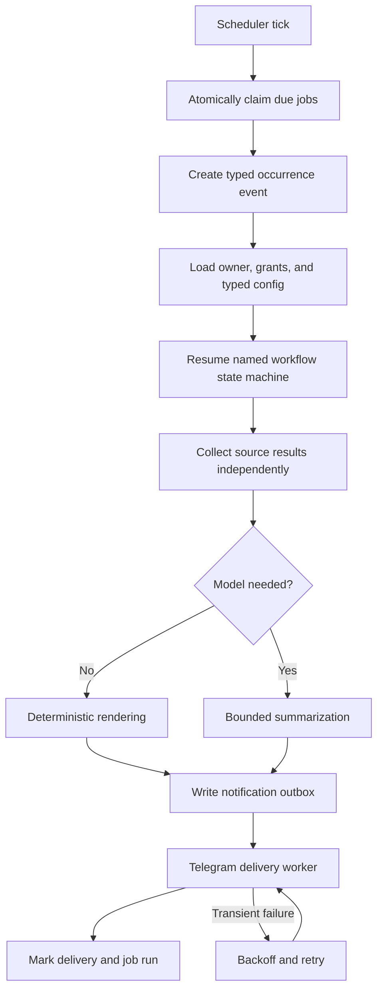
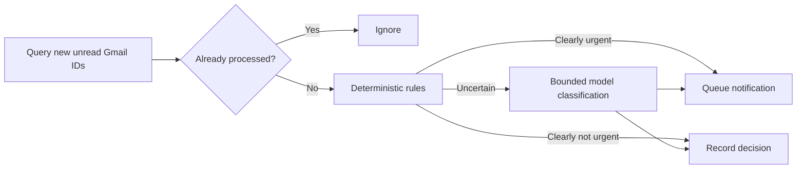

# Scheduling and Notifications

## Purpose

The system needs reliable proactive work: morning updates, urgent email alerts,
GitHub attention checks, Notion reminders, job-application reconciliation,
mentoring preparation, and integration health checks.

This is more than invoking a prompt from system cron. The application must know
who owns a job, whether an occurrence already ran, what happens after downtime,
and whether a notification was delivered.

## Design

Use an in-process scheduler backed by SQLite. Cron expressions or fixed
intervals describe timing; database records provide durability, leases,
deduplication, and audit.

System cron may start or monitor the container, but it is not the source of truth
for user workflows.

Scheduling and workflows are related but distinct. The scheduler creates a
typed occurrence event at a time; an automation pack’s explicit state machine
decides and checkpoints what that occurrence does. User commands, connector
changes, and edge-worker completions can trigger the same workflow mechanism.

## Scheduled job model

```text
id
principal_id
job_type
schedule_kind: cron | interval
schedule_expression
timezone
config_json
enabled
next_run_at
catch_up_policy
created_at
updated_at
```

Job configuration references safe, typed workflow parameters. It does not store
an arbitrary prompt to execute with unrestricted tools.

Job types are namespaced to their contributing module, for example
`briefing.morning`, `jobapply.reconcile`, or `mentoring.prepare`.

## Durable workflow model

The core persists workflow execution independently from the schedule that may
have triggered it:

```text
id
module_id
workflow_type
definition_version
principal_id
trigger_event_id or scheduled_occurrence
current_state
state_data_reference
status
attempt
next_attempt_at
pending_approval_id
created_at
updated_at
finished_at
```

Automation packs implement explicit, typed Go state transitions. The core owns
retry timing, checkpoint persistence, approval waits, audit correlation, and
outbox delivery. It does not execute a prompt-defined workflow or interpret a
general-purpose DSL.

## Job run model

```text
id
job_id
scheduled_for
dedupe_key = job_id + scheduled_for
lease_owner
lease_expires_at
status
attempt
started_at
finished_at
error_class
summary_metadata
```

A unique deduplication key guarantees one logical run per scheduled occurrence.
The lease allows recovery if the process exits mid-run.

## Scheduler flow



Each external side effect has an idempotency key. The workflow checkpoints the
result before advancing; a retry resumes from persisted state rather than
replaying the entire prompt or workflow.

## Timezone and daylight saving

- Store instants in UTC.
- Store the user’s IANA timezone, initially `Europe/Amsterdam`.
- Evaluate wall-clock schedules in that timezone.
- Define duplicate/nonexistent time behaviour around daylight-saving changes.
- Include `scheduled_for` in every run and deduplication key.

For a morning briefing, the intended policy is “once on each local calendar
day,” not “every 24 hours.”

## Catch-up policy

Each job declares one of:

| Policy | Behaviour after downtime | Example |
| --- | --- | --- |
| Skip | Move to the next future occurrence | Frequent health check |
| Run once | Run the latest missed occurrence once | Morning briefing |
| Replay bounded | Replay up to a configured limit | Rare accounting workflow |

Unlimited replay is not allowed.

## Notification outbox

Generating a notification and sending it are separate transactions. The outbox
contains:

```text
id
principal_id
chat_id
kind
payload or protected payload reference
dedupe_key
status
attempts
next_attempt_at
created_at
delivered_at
provider_message_id
```

The worker retries transient Telegram errors with exponential backoff and jitter.
Permanent errors disable or quarantine the delivery target rather than retrying
forever.

## Morning briefing

Proposed default schedule: configurable by the owner, with a starting example of
07:30 on weekdays in `Europe/Amsterdam`.

Sections are collected independently:

1. Calendar agenda
2. Important unread email
3. Notion tasks due or overdue
4. GitHub reviews and failing CI
5. NAS/network/service alerts

Each section has its own timeout and status. The final message names unavailable
sections rather than failing the entire briefing. The model receives bounded,
structured facts for summarization; it does not query sources itself during the
final formatting call.

## Urgent email workflow

Initial interval: five minutes.



Deterministic signals may include:

- configured senders or domains;
- Gmail labels and importance metadata;
- direct recipient versus mailing list;
- explicit deadline/incident vocabulary;
- user-defined exclusions and quiet hours.

The classifier returns a small schema such as priority, confidence, reason, and
whether to notify. Low confidence follows user policy rather than defaulting to
urgent.

Store the message ID and decision, but avoid retaining the body. Notifications
should contain the minimum useful snippet and a deep link where practical.

## GitHub attention workflow

Poll selected repositories every five or ten minutes using conditional requests.
Create events for newly failing Actions runs, new review requests, or status
transitions on tracked pull requests. Deduplicate by repository, object ID,
event kind, and relevant update timestamp.

Repository activity is often better grouped into the morning briefing unless it
represents a newly failing build the user explicitly wants immediately.

## Notion reminder workflow

Query explicitly configured task data sources. Determine due/overdue state from
typed properties rather than model interpretation. The model may summarize a
list, but it does not decide dates or ownership.

## Job-application workflow

Begin with manual and then scheduled observation runs. The workflow reads new
Gmail evidence and the selected Notion application record, deduplicates source
messages, and reports proposed transitions. It does not infer closure from age,
move status backward, or mark Ghosted without explicit agreement. The Gmail
connector remains read-only.

Advance the source checkpoint only after the complete run succeeds. An explicit
rejection may correct a provisional Ghosted state according to domain policy,
but any Notion mutation is introduced separately under the automation safety
model.

## Mentoring workflows

Preparation and reminder workflows may run from a manual command or a
calendar-relative schedule. Recording is never started merely because a job is
due: it requires fresh per-session consent and language selection before the
Mac edge worker receives a bounded request.

Session-note or roadmap publication is not an automatic scheduler action. It
must follow verification, duplicate protection, and the configured approval
level.

## Approval waits

When a workflow reaches a confirmed action, it stores an exact action hash and
enters `awaiting_approval`. The approval belongs to the same principal and
expires. Approval resumes that persisted instance; it does not cause the model
to reconstruct or reinterpret the action. Denial or expiry cancels the action
without losing the preceding audit trail.

## Monitoring alerts are separate

Prometheus/Grafana infrastructure alerts send directly to Telegram. They do not
depend on the application scheduler or model runtime. The scheduler may later
summarize alert history, but it is not the primary detector.

## Safety limits

- Maximum runtime and source-call timeout per job
- Maximum concurrent jobs globally and per principal
- Maximum model calls per occurrence
- Maximum notification size and frequency
- Quiet hours and daily notification budget
- Circuit breaker for repeatedly failing integrations
- Manual pause per job, integration, principal, or all proactive work

## Operational commands

Proposed deterministic commands:

- `/jobs` — list the caller’s enabled schedules
- `/pause <job>` — pause a job
- `/resume <job>` — resume a job
- `/run <job>` — run once with normal policy and audit
- `/notifications` — show recent delivery status without private content
- `/quiet` — view or change quiet hours after confirmation
