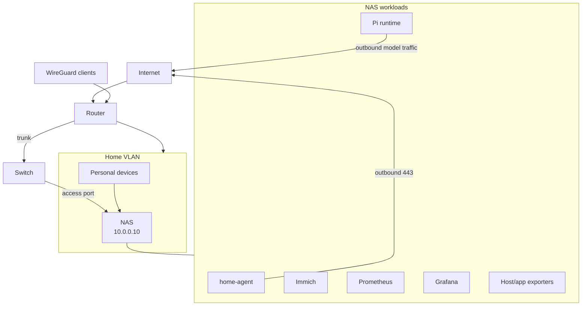

# Deployment and Network

## Hardware placement

### Primary host

NAS:

- x86_64 CPU
- Limited memory installed
- Wired network interfaces
- NAS address currently `10.0.0.10`
- Docker/container and virtual-machine capability

The CPU and network are sufficient. Memory is the limiting resource when
combined with Immich and monitoring.


### Edge device

The available single-board computer has Wi-Fi, BLE, and GPIO. It is not the primary host.

Possible later roles:

- independent DNS/network probe;
- temperature or humidity sensor gateway;
- BLE scanner;
- IR transmitter;
- physical approval button or status LED.


## Current network topology

The home network is segmented. The NAS sits on a trusted segment, other
segments cannot reach it, and remote administration uses a VPN.

## Deployment diagram



## Internet exposure

Default policy:

```text
Internet → NAS: no inbound port forwards
NAS → Telegram/OpenAI/Google/Notion/GitHub: outbound TLS
Home/WireGuard → Grafana/admin endpoints: allowed as configured
Other VLANs → NAS: blocked
```

Telegram uses outbound long polling. Existing VPN access already
solves remote administration. CloudFront, Cloudflare Tunnel, and additional DDNS
are not required for the initial agent.

## Container topology

Initial services:

| Service | Network exposure | Persistent data | Suggested memory envelope |
| --- | --- | --- | ---: |
| `home-agent` | Telegram/API egress; selected LAN endpoints | SQLite, configuration, credential references | 256–512 MB |
| `pi-runtime` | Model egress; private IPC with agent | Isolated auth/profile and optional session state | 256–768 MB |
| `prometheus` | Home/WireGuard or private only | Metrics TSDB | 512 MB–1 GB |
| `grafana` | Home/WireGuard only | Dashboards and alert config | 256–512 MB |
| exporters | Prometheus only | None | under 256 MB total |

These are planning envelopes, not measured requirements. Pi and model-request
memory must be measured on the target NAS before production deployment.

Do not add Loki, Alloy, Tempo, Home Assistant, or another database at launch.

## Eight-gigabyte feasibility

Without Home Assistant, the new steady-state services should fit in roughly
1–2.5 GB depending on Pi and Prometheus behaviour. The deployment is viable on
8 GB if Immich leaves sufficient headroom.

Upgrade criteria:

- sustained low `MemAvailable`, initially use 1–1.5 GB as an investigation
  threshold rather than a hard SLO;
- repeated swapping with user-visible latency;
- OOM kills or container restart loops;
- Immich machine-learning jobs starving control-plane services;
- adding Loki/Tempo or virtual machines.

If triggered, 16 GB is the practical minimum upgrade; 32 GB provides comfortable
growth. The hardware supports larger capacity.

## Volumes and permissions

Proposed logical volumes:

```text
home-agent/data/          SQLite and application state
home-agent/config/        Non-secret configuration
home-agent/credentials/   Protected credential material
home-agent/pi/user-a/     Isolated Pi profile for user A, if Pi is adopted
home-agent/pi/user-b/     Separate profile only if independently authorized
home-agent/logs/          Rotated structured operational logs
prometheus/               Metrics data
grafana/                  Dashboards and alert configuration
```

NAS content roots are mounted read-only and separately from application state.
Pi does not receive NAS content mounts in the generic runtime configuration.
The application state directory is private (`0700`) and must live below
operator-controlled parent directories; the SQLite database and its WAL files
are private (`0600`). The service rejects an existing data directory with a
broader mode instead of changing permissions on an operator-supplied path.

## Container security

- Non-root user where supported
- Read-only root filesystem where practical
- Drop Linux capabilities
- No privileged mode
- No Docker socket
- No host PID namespace
- Explicit outbound destinations where enforceable
- Health checks and restart policy
- Memory/CPU limits based on measured behaviour
- Secrets supplied through protected files or a supported secret mechanism,
  never committed configuration

## Network hardening path

The Home VLAN provides more reach than the agent needs. Before enabling
infrastructure or account writes, choose one:

1. Assign the agent container a unique macvlan/ipvlan address and restrict it by
   source address in UniFi.
2. Add a Services VLAN and place the workload or NAS service interface there.
3. Use a constrained VM with a dedicated network identity.

The preferred rule shape is explicit allow to required APIs and LAN services,
then deny access to Work, Guest, and unrelated IoT segments.

## Backup and restore

Back up:

- SQLite database using a transaction-consistent mechanism;
- non-secret configuration and dashboard provisioning;
- encrypted credential records or documented re-authorization procedures;
- Pi session state only if it becomes part of the product contract.

Do not assume a backup is valid until a restore has been tested. Audit logs and
metrics have lower recovery priority than principals, schedules, grants, and
outbox state.
