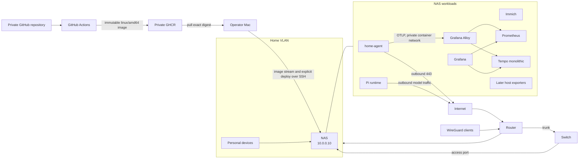

# Deployment and Network

## Hardware placement

### Primary host

NAS:

- x86_64 CPU
- Limited memory installed
- Wired network interfaces
- NAS address currently `10.0.0.10`
- Docker/container and virtual-machine capability

The CPU and network are sufficient. Memory is the limiting resource when
combined with Immich and monitoring.


### Edge device

The available single-board computer has Wi-Fi, BLE, and GPIO. It is not the primary host.

Possible later roles:

- independent DNS/network probe;
- temperature or humidity sensor gateway;
- BLE scanner;
- IR transmitter;
- physical approval button or status LED.


## Current network topology

The home network is segmented. The NAS sits on a trusted segment, other
segments cannot reach it, and remote administration uses a VPN.

## Deployment diagram



## Internet exposure

Default policy:

```text
Internet → NAS: no inbound port forwards
NAS → Telegram/OpenAI/Google/Notion/GitHub: outbound TLS
Home/WireGuard → Grafana/admin endpoints: allowed as configured
Other VLANs → NAS: blocked
```

Telegram uses outbound long polling. Existing VPN access already
solves remote administration. CloudFront, Cloudflare Tunnel, and additional DDNS
are not required for the initial agent.

The first deployment binds Grafana to NAS loopback rather than the LAN. An
operator reaches it from the Mac with an SSH local-forward such as
`ssh -L 3000:127.0.0.1:3000 home-nas`, then opens
`http://127.0.0.1:3000`. Prometheus, Tempo, Alloy, application health, and OTLP
listeners stay on the private container network or NAS loopback. No service is
published to the internet.

## Build and deployment flow

The source lives in a private GitHub repository. GitHub Actions validates the
repository, builds only the required `linux/amd64` production image initially,
and publishes it to private GitHub Container Registry (GHCR) under an immutable
commit-SHA tag and digest. CI uses the repository's short-lived `GITHUB_TOKEN`
with only `contents: read` and `packages: write`; it receives no NAS, Telegram,
Grafana, or application runtime credentials. See GitHub's official guidance for
[publishing Docker images](https://docs.github.com/en/actions/tutorials/publish-packages/publish-docker-images)
and [package permissions](https://docs.github.com/en/packages/learn-github-packages/about-permissions-for-github-packages).

Production deployment is never a CI side effect. The operator selects an exact
digest and deploys from the Mac:

1. Authenticate the local Docker client to private GHCR using a credential held
   by the Mac's native credential store.
2. Pull the selected digest explicitly for `linux/amd64`.
3. Stream `docker image save` stdout through `ssh home-nas` to
   `docker image load` on the NAS.
4. Synchronize only version-controlled, non-secret Compose and provisioning
   files.
5. Materialize the required runtime secrets from Keychain into protected NAS
   files without printing them or placing them in command arguments.
6. Start Compose with registry pulling disabled.
7. Require container health, application readiness, and telemetry checks to
   pass; otherwise restore the previously recorded image digest.

This leaves no deployment archive and no private-registry credential on the
NAS. It requires enough temporary Docker storage on the Mac and NAS for the new
and previous images. Retain at least the last known-good image until the new
deployment passes its verification gate. Docker documents both
[`docker image save`](https://docs.docker.com/reference/cli/docker/image/save/)
and [`docker image load`](https://docs.docker.com/reference/cli/docker/image/load/).

## SSH operator access

The NAS account holds only the public half of a dedicated Ed25519 key in its
`authorized_keys`. The encrypted private key never leaves the Mac, and its
passphrase is cached through macOS Keychain. `~/.ssh/config` defines the
`home-nas` alias with the verified address, operator account, port, identity
file, `IdentitiesOnly yes`, `AddKeysToAgent yes`, and `UseKeychain yes`.

Before changing Docker permissions or choosing storage paths, verify the NAS in
person or through its trusted administration UI, validate the SSH host-key
fingerprint, then inventory architecture, account UID/GID, Docker Engine,
Docker Compose, filesystem capacity, and Docker-socket access. Docker control
is effectively root-equivalent; do not grant it to a broad household account
or mount the socket into the application. The NAS vendor documents its
Terminal controls and
firewall configuration.

## Container topology

Initial services:

| Service | Network exposure | Persistent data | Suggested memory envelope |
| --- | --- | --- | ---: |
| `home-agent` | Telegram/API egress; private OTLP/health endpoints | SQLite and application state | 256–384 MB |
| `pi-runtime` | Model egress; private IPC with agent | Isolated auth/profile and optional session state | 256–768 MB |
| `alloy` | Private OTLP input and backend output only | Normally none | 128–256 MB |
| `prometheus` | Private only | Metrics TSDB | 512 MB–1 GB |
| `tempo` | Private only, monolithic mode | Trace blocks and WAL | 256–512 MB |
| `grafana` | NAS loopback only | Internal database, dashboards, alert state | 256–512 MB |
| later host exporters | Prometheus only | None | under 128 MB total |

These are conservative planning envelopes, not measured requirements or a
license to reserve every maximum simultaneously. Compose starts with protective
limits for the initial services; adjust them only from observed startup and
steady-state evidence. A limit that causes restart loops is worse than a
measured alert threshold. Pi, Prometheus, and Tempo behaviour must be measured
on the target NAS before production use.

Grafana is the query, dashboard, and alert interface; it does not bundle
Prometheus or Tempo. Alloy is the OpenTelemetry collector and routing layer.
Loki is deliberately excluded at launch: structured stdout logs use bounded
container rotation, and local log aggregation is added only after a measured
need. Home Assistant and another application database also remain deferred.
See the official [Grafana data-source documentation](https://grafana.com/docs/grafana/latest/datasources/)
and [Grafana Alloy introduction](https://grafana.com/docs/alloy/latest/introduction/).

## Eight-gigabyte feasibility

The application and observability stack, excluding Pi, should be budgeted at
roughly 1.4–2.8 GB including container/runtime overhead. Adding Pi raises the
planning range to roughly 1.7–3.6 GB before Immich and filesystem cache. These
are deliberately cautious estimates; deployment on 8 GB is conditional on an
idle and load-test baseline that leaves meaningful memory available to NAS OS,
Immich, and the kernel page cache.

Upgrade criteria:

- sustained low `MemAvailable`, initially use 1–1.5 GB as an investigation
  threshold rather than a hard SLO;
- repeated swapping with user-visible latency;
- OOM kills or container restart loops;
- Immich machine-learning jobs starving control-plane services;
- adding Loki, additional Tempo components, or virtual machines.

If triggered, 16 GB is the practical minimum upgrade; 32 GB provides comfortable
growth. The hardware supports larger capacity.

## Volumes and permissions

Proposed logical volumes:

```text
home-agent/data/          SQLite and application state
home-agent/config/        Non-secret configuration
home-agent/secrets/       Protected runtime copies, separate from deployment files
home-agent/pi/user-a/     Isolated Pi profile for user A, if Pi is adopted
home-agent/pi/user-b/     Separate profile only if independently authorized
prometheus/               Metrics data
tempo/                    Trace blocks and WAL
grafana/                  Dashboards and alert configuration
```

These are logical names, not assumed NAS OS paths. The operator must select
absolute NAS locations only after checking the live volume layout, filesystem,
backup policy, and the UID/GID used by each container. Compose bind mounts must
use those validated absolute paths.

NAS content roots are mounted read-only and separately from application state.
Pi does not receive NAS content mounts in the generic runtime configuration.
The application state directory is private (`0700`) and must live below
operator-controlled parent directories; the SQLite database and its WAL files
are private (`0600`). The service rejects an existing data directory with a
broader mode instead of changing permissions on an operator-supplied path.

macOS Keychain is the canonical store for runtime secrets. The NAS keeps only
the decrypted copies required by an always-running service, in a dedicated
directory with mode `0700`; each secret file has mode `0600`, appropriate
ownership, and a read-only mount visible only to its consumer. Secrets never
enter Git, Compose environment values, image layers, CI, shell command
arguments, or logs. File-backed secrets are preferred because environment
values are visible through container inspection. Docker documents the
[Compose secrets model](https://docs.docker.com/compose/how-tos/use-secrets/).

Compose implementations commonly bind-mount file-backed secrets and may not
honour requested UID/GID/mode overrides. Validate the actual in-container mode
and readability on this NAS before starting the application. Do not broaden a
file beyond `0600` to make a mismatched container UID work; align ownership or
the container identity instead.

## Container security

- Non-root user where supported
- Read-only root filesystem where practical
- Drop Linux capabilities
- No privileged mode
- No Docker socket
- No host PID namespace
- Explicit outbound destinations where enforceable
- Health checks and restart policy
- Memory/CPU limits based on measured behaviour
- Secrets supplied through protected files or a supported secret mechanism,
  never committed configuration

## Network hardening path

The Home VLAN provides more reach than the agent needs. Before enabling
infrastructure or account writes, choose one:

1. Assign the agent container a unique macvlan/ipvlan address and restrict it by
   source address in UniFi.
2. Add a Services VLAN and place the workload or NAS service interface there.
3. Use a constrained VM with a dedicated network identity.

The preferred rule shape is explicit allow to required APIs and LAN services,
then deny access to Work, Guest, and unrelated IoT segments.

## Backup and restore

Back up:

- SQLite database using a transaction-consistent mechanism;
- non-secret configuration and dashboard provisioning;
- encrypted credential records or documented re-authorization procedures;
- Pi session state only if it becomes part of the product contract.

Do not assume a backup is valid until a restore has been tested. Audit logs and
metrics have lower recovery priority than principals, schedules, grants, and
outbox state.
