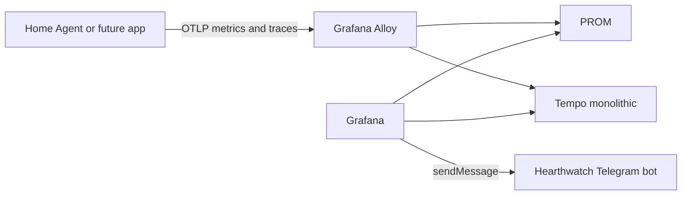

# Observability and Operations

## Objectives

Observability should answer:

- Is the application running and receiving Telegram updates?
- Which integration is slow or failing?
- Did a schedule run, and was its notification delivered?
- Was a tool denied, confirmed, executed, or retried?
- Is the NAS under memory, disk, or container pressure?
- Can an operator diagnose failure without reading personal content?

## Initial stack

Deploy the observability stack before the application:

- OpenTelemetry Go SDK instrumentation for application metrics and traces;
- Grafana Alloy as the private OTLP receiver and routing layer;
- Prometheus as the metrics store;
- Tempo in monolithic mode as the trace store;
- Grafana as the local query, dashboard, and alert interface;
- structured JSON logs on stdout with bounded container rotation;
- structured security and action audit data in SQLite.



Grafana does not contain Prometheus, Tempo, or Loki under the hood. It queries
separate data sources and owns dashboards and alerts. Alloy is Grafana Labs'
OpenTelemetry Collector distribution; it receives OTLP from the application
and routes each signal to its backend. See the official
[Grafana data-source documentation](https://grafana.com/docs/grafana/latest/datasources/),
[Alloy introduction](https://grafana.com/docs/alloy/latest/introduction/), and
[Tempo deployment modes](https://grafana.com/docs/tempo/latest/reference-tempo-architecture/deployment-modes/).

Loki remains explicitly deferred. Initial logs stay local because collecting
all container or host logs would add storage, permissions, and operational
cost. The application includes trace and span IDs in structured logs, so an
operator can correlate a local log entry with Tempo without a log backend. Add
Loki only when repeated incidents demonstrate that bounded local log inspection
is insufficient. The all-in-one
[`docker-otel-lgtm` image](https://grafana.com/docs/opentelemetry/docker-lgtm/)
is suitable for development and demonstrations, not this long-running NAS
deployment; production uses separate pinned containers and persistent stores.

Host and NAS metrics are also deferred from the first installation. Add a
narrowly exposed exporter only after the live NAS OS interfaces, filesystem
permissions, container visibility, and useful alert signals have been verified;
the application must never receive the Docker socket for this purpose.

## Correlation model

Use stable opaque identifiers:

```text
request_id
turn_id
principal_id (pseudonymous)
session_id
job_id
job_run_id
tool_call_id
approval_id
outbox_message_id
```

Propagate them through traces, logs, metric attributes only where cardinality
permits, and audit records. `trace_id` and `span_id` correlate logs to Tempo but
must not become metric attributes. Never attach Telegram messages or usernames,
raw Telegram IDs, bot tokens, API URLs containing tokens, email addresses,
paths, subjects, prompts, filenames, or third-party response bodies to
telemetry.

OpenTelemetry resources use stable low-cardinality attributes such as a
service-specific `service.name`, a deployment environment, and an explicit
service version. Metric and span attributes use bounded enums such as command,
outcome, safe error class, and integration name. Principal and request
identifiers stay out of metrics; pseudonymous identifiers may appear in
protected logs or audit only when required for diagnosis or accountability.

## Application metrics

### Ingress

- Telegram polling success/failure count
- Update processing lag
- Updates accepted/rejected by reason
- Outbound Telegram requests, latency, retries, and permanent failures
- Durable polling cursor advancement failures

### Runtime

- Runtime process availability and restarts
- Turns started/completed/failed/aborted
- Time to first token and total turn latency
- Model/provider error class
- Input/output/cache token counts when available
- Context compaction and retry counts

### Tools and integrations

- Tool requests by capability and outcome
- Policy allow/deny/confirmation counts
- Adapter request latency and error class
- Timeouts, rate limits, and circuit-breaker state
- Result count/size buckets

### Scheduling

- Enabled jobs and overdue jobs
- Runs by status and duration
- Lease recovery count
- Missed and catch-up occurrences
- Outbox queue depth and oldest message age
- Notification attempts and delivery latency

### Process and host

- CPU, RSS, file descriptors, goroutines, and GC
- NAS memory available, swap activity, load, and filesystem capacity
- Container restart/OOM state where safely observable
- Disk/array/backup health through supported sources

## Logs

Use structured logs on stdout with levels and stable event names. The container
runtime applies both size and file-count rotation. Log operational events, not
conversational content.

Examples:

```text
telegram.update.accepted
principal.unknown
runtime.started
runtime.failed
tool.policy_denied
tool.completed
job.claimed
job.completed
outbox.delivery_retry
integration.circuit_open
```

Errors should be normalized into safe classes. Raw third-party responses may
contain personal content or tokens and should not be logged automatically.
Telegram HTTP client instrumentation must be manual or sanitized because the
Bot API token is part of the request URL. Do not install generic HTTP telemetry
that records that URL.

## Audit

Audit differs from logs: it records security- and action-relevant facts in a
stable schema.

Minimum audit event:

```text
timestamp
actor principal
request/job origin
capability and version
resource scope reference
policy decision
approval reference, if any
attempt and idempotency reference
outcome and safe error class
duration
```

Audit retention should be longer than debug logs but still bounded. Exact
retention is an open decision based on storage and privacy preference.

## Tracing

Instrument the application with OpenTelemetry spans and export them through
OTLP to Alloy. At minimum:

```text
telegram.receive
identity.resolve
runtime.turn
tool.policy
integration.request
scheduler.run
telegram.send
```

Span names remain stable and low-cardinality. Record safe state transitions and
normalized outcomes, not request content. The low-volume deterministic shell
initially exports every span so deployment can verify the full path. Introduce
sampling only from measured trace volume, while keeping failures diagnosable
without turning message content into telemetry.

The exporter has bounded queues, timeouts, and shutdown flushing. Loss of Alloy,
Prometheus, Tempo, or Grafana degrades observability but must not stop Telegram
polling after the application has otherwise started successfully. Readiness
reports the application dependencies needed to serve users, not dashboard
availability.

## Dashboards

The dashboards are provisioned from `deploy/grafana/dashboards`; Grafana
rereads the directory every 30 seconds and keeps the dashboards read-only in
the interface, so a change is made in the JSON and deployed, never saved from
the browser.

### Home Agent overview

- Availability
- Telegram lag and errors
- Turn rate, latency, and failures
- Runtime restarts
- Integration health
- Pending jobs and outbox depth

### Home Agent runtime

- Process and container CPU against the one-core Compose limit
- Container memory against the 1 GiB limit, and process resident set size
- Container PIDs against the limit
- SQLite connection pool usage, maximum, and connection waits
- Uptime, goroutines, and the deployed commit
- A link to Go runtime for this service

### Go runtime

- Go memory by class, the collection goal, and GOMEMLIMIT
- Heap allocation rate in bytes and in objects
- Garbage collection cycles, pause duration, and the collector's share of CPU
- Goroutines, operating system threads, and open file descriptors
- Process CPU and the Go runtime CPU classes
- Disk and network I/O, page faults, and context switches
- Any service that reports Go runtime metrics, selected by service name

### Integrations

- Per-source latency/error rate
- Rate-limit events
- OAuth refresh failures
- Circuit-breaker state

### NAS capacity

- Memory available and swap
- CPU/load
- Storage capacity and growth
- Disk/array status
- Container restarts

### Scheduler

- Upcoming runs
- Runs by status
- Missed/caught-up jobs
- Notification delivery latency

## Alerts

Infrastructure alerts go directly from Grafana to Telegram through a dedicated
alert contact path. They must not depend on the model runtime.

Use a separate Telegram bot for this contact point so an application-bot token
or failure does not also disable infrastructure alerts. `Hearthwatch` is the
preferred display name and a username such as `HearthwatchAlertsBot` is a
candidate, subject to BotFather availability. The alert bot token is readable
only by Grafana. `Hearthkeeper`, the main interaction bot, remains readable only
by the home-agent service. Test alerts must contain operational state, never
messages, prompts, usernames, or secret values.

Initial alert candidates:

- Home agent unavailable
- Telegram polling stalled
- Runtime crash loop
- Scheduled job overdue
- Outbox oldest message exceeds threshold
- OAuth refresh repeatedly failing
- Integration circuit open for a sustained period
- NAS low available memory, swap pressure, or disk-capacity threshold
- Backup age exceeds policy

Alert thresholds should be tuned from observed baseline rather than invented as
permanent constants.

## Health endpoints

- Liveness: process event loop responds; no external dependency checks.
- Readiness: database available, migrations complete, Telegram configuration
  valid, and runtime can be started.
- Detailed admin health: per-integration status, accessible only from authorized
  local/admin paths.

An unavailable optional integration should degrade readiness only if the current
deployment declares it required.

## Retention and resource limits

Starting points:

- Metrics: 15 days with an explicit TSDB size ceiling
- Traces: 7 days, plus a volume-capacity alert and measured storage budget
- Local operational logs: 7–14 days with size and file-count rotation
- Audit: 30–90 days, subject to privacy decision
- No prompt/body capture
- Scrape interval: 30–60 seconds

Measure Prometheus and Tempo disk/memory growth before increasing retention,
sampling, or scrape frequency. Alert before their volumes threaten application
state or NAS capacity. Tempo monolithic mode is intentionally a single-instance
deployment for this low-volume host; horizontal scale is not a current goal.

## Access and deployment checks

Grafana binds to the configured NAS LAN address (currently
`http://10.0.0.10:3000`); no observability port is forwarded from the router.
Prometheus, Tempo, Alloy, and OTLP listeners remain private to the Compose
network.

Provision the Prometheus and Tempo data sources rather than clicking them into
existence. The monitoring project must be usable while no application is
running. Deployment is acceptable only when:

- all four observability containers remain running and their readiness
  endpoints respond;
- Grafana can query Prometheus and Tempo;
- a known application action, when an application is deployed, creates both
  expected metrics and a trace;
- logs for that action contain matching trace/span IDs but no content;
- the Hearthwatch contact point delivers a safe test alert;
- container restart preserves dashboards, metrics, and trace storage within
  their documented retention expectations.

## Backup and recovery checks

Operational readiness includes:

- automated SQLite backup status;
- age of latest successful backup;
- periodic restore exercise;
- documented token re-authorization;
- recovery of schedules without duplicate runs;
- recovery of pending outbox messages without duplicate delivery.

## Evaluation

Evals are separate from infrastructure monitoring. Maintain a small regression
set covering:

- correct tool selection;
- unknown/unauthorized user denial;
- cross-user credential isolation;
- prompt injection in source content;
- ambiguous urgent-email classification;
- integration timeout and partial briefing;
- confirmation binding and expiry;
- duplicate scheduled occurrence handling.

The set should remain small and tied to real failures. It is not a separate ML
platform.
