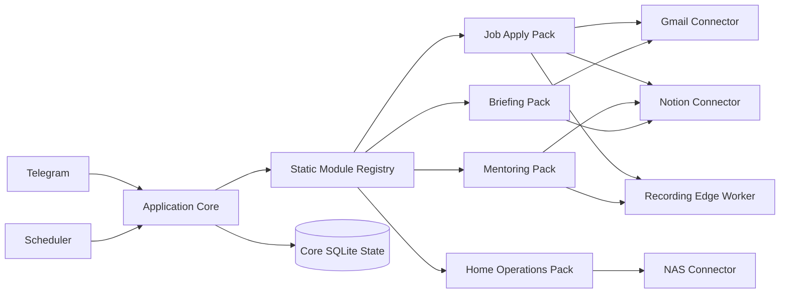
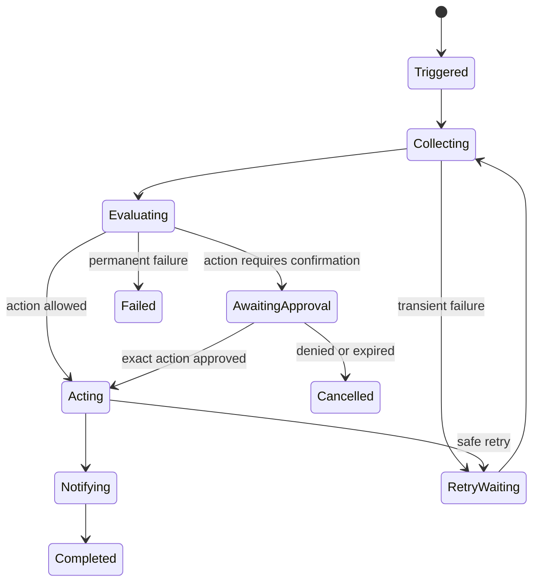

# Module and Automation Model

## Status and intent

This document defines the accepted modular design for the platform. The term
“plugin” describes a product boundary, not a dynamically loaded Go binary. The
initial application is one statically compiled Go executable with modules
registered at build time and enabled through configuration.

The goal is to make new personal automations independently understandable and
removable without giving them independent access to policy, credentials, or
storage internals.

## Taxonomy

The platform has four kinds of component:

| Kind | Examples | Responsibility |
| --- | --- | --- |
| Core | Identity, policy, scheduler, workflow state, approvals, audit, outbox | Cross-cutting security and execution guarantees |
| Connector | Gmail, Notion, GitHub, NAS, UniFi, Immich | Narrow, typed access to one external system |
| Automation pack | Job applications, mentoring, morning briefing, home operations | Domain rules and workflows composed from connectors |
| Edge worker | macOS recording/transcription, future Pi sensor process | Device-specific work that cannot or should not run on the NAS |

A connector does not contain job-application or mentoring policy. An automation
pack does not implement OAuth, Telegram delivery, or its own approval system.
An edge worker does not become a second control plane.



Arrows from automation packs to connectors represent declared dependencies,
not unrestricted direct access. Calls still pass through core policy and
credential resolution.

## Why modules are statically compiled

Go’s native dynamic plugin mechanism has portability, toolchain-compatibility,
deployment, and trust-boundary costs that provide little benefit for a private
single-instance system. Initially:

- module implementations are ordinary Go packages;
- the executable imports and registers built-in modules explicitly;
- configuration enables modules and supplies non-secret settings;
- missing optional dependencies disable only affected contributions;
- updating module code follows the normal build and deployment path.

This provides modular ownership without creating an in-process third-party
extension security model. A versioned JSON-RPC or gRPC sidecar protocol can be
introduced later if independently deployed or non-Go modules become a real
requirement.

## Core ownership

The core exclusively owns:

- principal identity, grants, and credential references;
- policy evaluation and capability risk classification;
- scheduling and trigger delivery;
- durable workflow instances, retries, and checkpoints;
- approval creation, expiry, resolution, and action binding;
- audit metadata and correlation identifiers;
- notification outbox and Telegram delivery;
- runtime/tool brokering and result-size enforcement;
- module lifecycle, dependency validation, and health aggregation.

Modules must not bypass these facilities or create parallel implementations of
them. In particular, an automation pack cannot send Telegram messages directly,
load another principal’s secret, or execute a confirmed action from a prompt
without a core approval record.

## Module contract

The initial scaffold separates module identity and lifecycle from the future
contribution surface. The implemented lifecycle contract is deliberately small:

```go
type Module interface {
	Descriptor() Descriptor
	Start(context.Context) error
	Ready(context.Context) error
	Shutdown(context.Context) error
}
```

The descriptor currently declares a stable module ID, semantic version, kind,
and dependencies. The registry validates duplicate IDs, missing dependencies,
dependency cycles, and deterministic startup order before the application is
ready.

A separate narrow contribution registrar will be introduced with the first
real connector or automation pack. It will add configuration requirements and
capability declarations without passing the complete application into a module.
The following contribution points are architectural direction, not implemented
scaffold features.

A module may contribute:

- typed tools and their risk metadata;
- Telegram commands;
- event sources and handlers;
- named durable workflow definitions;
- scheduled-job types;
- health checks and metrics;
- namespaced state migrations;
- deterministic renderers for notifications.

A module does not receive:

- the complete application object;
- unrestricted SQLite access;
- raw access to the secret backend;
- arbitrary filesystem or network authority;
- a way to expose tools directly to Pi;
- a way to override identity, policy, approval, or audit decisions.

Core services supplied to a contribution should be narrow interfaces. Connector
operations are invoked with a principal-bound execution context, typed input,
deadlines, and an explicit capability grant.

## Dependency and lifecycle rules

- Module IDs and contribution names are globally stable and namespaced.
- Dependencies are declared, validated at startup, and must not form cycles.
- Optional dependencies produce a degraded health state rather than a startup
  failure when the module declares a safe degraded mode.
- Configuration determines enablement; a model cannot enable a module.
- Startup registration is deterministic and completes before ingress begins.
- Shutdown stops new work, checkpoints recoverable state, and drains bounded
  in-flight work.
- A module’s migrations and persistent records remain namespaced even though
  SQLite is physically shared.

## Typed events

Connectors and edge workers emit typed facts. They do not submit free-form
prompts as events.

An event envelope contains at least:

```text
event_id
event_type
schema_version
occurred_at
observed_at
principal_id or shared-resource scope
source
source_reference
dedupe_key
correlation_id
payload
```

Examples include `gmail.message.observed`, `github.check.changed`,
`recording.transcript.ready`, and `nas.capacity.threshold_crossed`. Payloads have
versioned schemas and bounded sizes. Event consumers must tolerate duplicate
delivery; idempotency comes from the event or workflow deduplication key.

Events are facts, not authorization. A source event may start a workflow, but
the workflow still evaluates current grants and policy before each external
operation.

## Durable workflows

Automation packs implement explicit Go state machines. The core persists their
progress and provides generic execution mechanics; it does not interpret a
workflow DSL.

Each workflow instance records:

```text
id
workflow_type
definition_version
module_id
principal_id
trigger_event_id or scheduled_occurrence
current_state
state_data_reference
status
attempt
next_attempt_at
pending_approval_id
created_at
updated_at
finished_at
```

The workflow definition maps a known state and typed event to one of a small set
of outcomes: checkpoint, call a connector, request approval, queue a
notification, complete, or fail. Side effects use idempotency keys and their
results are checkpointed before another step is attempted.



This design is intentionally smaller than Temporal, LangGraph, or a general
automation language. Reconsider an external workflow system only after measured
requirements exceed one process and SQLite—for example, long-running workflows
distributed across several independent workers with high concurrency.

## Automation safety levels

Every contributed operation has one of four execution levels:

| Level | Name | Behaviour | Examples |
| --- | --- | --- | --- |
| 1 | Observe | Read and classify without changing an external source | Search Gmail, inspect NAS health, calculate application statistics |
| 2 | Notify | Automatically create a bounded local/outbox notification | Urgent-mail alert, morning briefing, failed-CI alert |
| 3 | Bounded write | Perform a narrow, reversible, idempotent write allowed by explicit policy | Create a preconfigured Notion Inbox item after the capability is promoted |
| 4 | Confirmed action | Bind an exact action to a named, expiring same-principal approval | Mark an application Ghosted, publish notes, alter infrastructure |

These levels complement capability risk classes. Levels describe how automation
may execute an operation; risk classes describe the effect of the underlying
capability. A high-impact write is never reduced to a lower safety level merely
because a workflow is scheduled.

The initial product enables Levels 1 and 2. Level 3 is introduced one operation
at a time after validation. Level 4 requires the core approval state machine.
Some operations—sending email, submitting or withdrawing applications, deleting
files, and changing network configuration—remain unavailable even with a model
request until explicitly designed.

## Job-apply automation pack

The job-apply pack owns employment-search domain rules and composes shared
platform capabilities:

```text
job-apply pack
├── Gmail connector: read/search only
├── Notion connector: selected application database
├── web retrieval: bounded job/company source fetches
├── artifact store: CV, job snapshot, preparation, transcript references
└── recording edge worker: interview capture and local transcription
```

Candidate workflows include:

- application statistics and funnel summaries;
- read-only mailbox reconciliation with proposed status changes;
- interview reminders and preparation assembly;
- follow-up and “who owes whom” reminders;
- explicit-rejection reconciliation;
- interview recording/transcript processing;
- generation of copyable follow-up text without sending email.

The pack, rather than Gmail or Notion connectors, enforces domain invariants:

- do not infer application closure merely from age;
- an explicit rejection overrides a provisional Ghosted state;
- never move an application status backward automatically;
- Ghosted closure requires explicit user agreement;
- deduplicate processed source messages;
- advance a polling checkpoint only after the complete run succeeds;
- keep Gmail read-only and do not draft or send mail initially.

Migration starts in observation mode. The new pack runs against representative
inputs and compares its proposals with the existing `job-apply` workflow before
any bounded Notion update is enabled.

## Mentoring automation pack

The mentoring pack owns mentoring-specific workflows and composes the shared
Notion connector and recording edge worker.

Candidate workflows include:

- locate a mentee without accepting ambiguous matches;
- prepare a session from the roadmap, previous notes, and commitments;
- remind about commitments or a next session;
- create a session record through a bounded Notion operation;
- import or update a roadmap with duplicate protection;
- process a verified transcript into proposed notes.

Recording has stricter boundaries:

- require explicit consent for every session;
- require the session language explicitly;
- refuse to start while unclaimed audio is present;
- archive original audio before transcription;
- preserve the transcript verbatim and record its integrity metadata;
- verify resulting Notion content before reporting success.

The NAS coordinates the workflow, but macOS performs recording and local
transcription because microphone/system-audio permissions and the existing
capture tooling live there. Raw audio is not ordinary model or module input.

## Shared connectors and edge capabilities

| Shared capability | Consumers | Boundary |
| --- | --- | --- |
| Gmail connector | Job apply, urgent mail, morning briefing | Per-principal OAuth; read-only initially |
| Notion connector | Job apply, mentoring, reminders, briefing | Explicitly shared roots and typed schemas |
| Recording edge worker | Job interviews, mentoring sessions | Per-session consent; local audio archive and transcription |
| GitHub connector | Development awareness, future project workflows | Selected repositories and read-only permissions initially |
| NAS connector | Home operations, artifact references | Configured read-only roots; no Docker socket |
| Notification outbox | Every automation pack | Core-owned delivery, deduplication, and retry |

Shared code does not imply shared authority. Every connector call still resolves
the initiating principal and resource grant.

## Incremental migration

The existing `job-apply` and `mentoring` repositories remain operational during
migration. They contain proven domain behaviour, data, credentials, and
device-specific tooling that should not be moved wholesale.

For each capability:

1. Inventory current inputs, outputs, invariants, and failure behaviour.
2. Introduce or reuse the narrow shared connector.
3. Implement the automation workflow in Level 1 observation mode.
4. Run both paths on representative data and compare results.
5. Add notifications without source mutation.
6. Promote one bounded write only after parity, idempotency, rollback, and audit
   have been verified.
7. Move ownership of state or credentials only when the new path is stable.
8. Retire the old capability explicitly; do not remove the original repository
   as a side effect of enabling the pack.

Wrapping an existing Python command behind a narrow edge/adapter contract is
acceptable during migration. Rewriting into Go is not itself a product goal.

## Proposed package direction

```text
cmd/home-agent/
internal/core/
internal/module/
internal/runtime/pi/
internal/workflow/
internal/policy/
internal/approval/
internal/scheduler/
internal/outbox/
internal/audit/
internal/connectors/gmail/
internal/connectors/notion/
internal/connectors/github/
internal/connectors/nas/
internal/features/jobapply/
internal/features/mentoring/
internal/features/briefing/
internal/edge/recording/
```

This is a direction, not a requirement to create every package before its first
capability exists.

## Explicit non-goals for the first implementation

- Loading arbitrary third-party code at runtime
- A module marketplace or remote installation mechanism
- A user-authored workflow DSL
- Temporal, Kafka, Redis, or distributed orchestration
- Letting automation packs own independent credential stores
- Moving existing repositories or private data wholesale
- Automatically expanding an integration’s permissions when a pack is enabled
