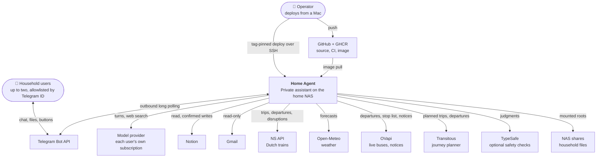
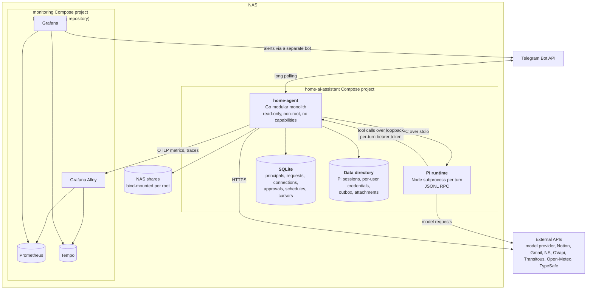
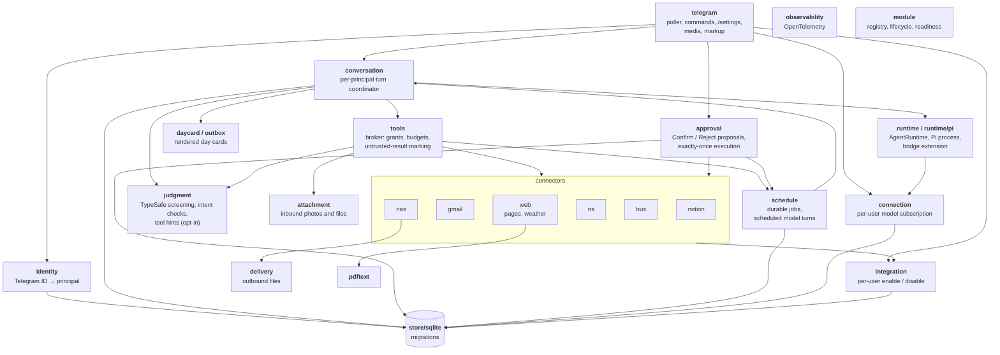

# Architecture

The diagrams follow the [C4 model](https://c4model.com): system context, then
containers, then the components inside the Go application. They describe what is
built; see [plans](plans/README.md) for how each part came to be.

## 1. System context

Nothing listens on the internet. Telegram is polled outbound, every integration is
an outbound HTTPS client, and administrative interfaces stay on the LAN.

## 2. Containers

| Container | Responsibility |
| --- | --- |
| `home-agent` | Everything with authority: identity, policy, tools, credentials, approvals, scheduling, delivery, telemetry |
| Pi runtime | The model loop only. It gets no built-in tools, skills, or project context; its tools are the bridge extension that calls back into `home-agent` |
| SQLite | Durable control-plane state through `modernc.org/sqlite` (pure Go, no CGO) |
| Data directory | Mode `0700`; Pi session history, per-user integration credentials, and pending day cards |
| Monitoring | Separate repository and Compose project, joined through a private Docker network |

## 3. Components of `home-agent`

`internal/app` wires these together. Each connector registers with the module
registry (lifecycle and readiness), the tool broker (the tools it offers), and, if
it can write, the approval service (the executor for confirmed proposals).

### A conversation turn

1. `telegram` receives an update, `identity` resolves the sender to a principal, and
   anything from an unknown user or a non-private chat is dropped.
2. The request is persisted before the polling cursor advances, so a restart never
   loses or replays an accepted message.
3. `conversation` claims it, resolves the principal's own model connection, and
   collects only the tools that principal has granted and enabled.
4. `runtime/pi` starts Pi with a private per-turn directory containing the bridge
   extension and those tool definitions.
5. Every tool call returns over loopback to `tools`, which rechecks the grant and
   bounds it to 15 seconds, 16 KiB, and 8 calls per turn.
6. A write becomes a proposal; `approval` sends Confirm and Reject after the reply
   and executes a confirmed proposal once.
7. The reply goes back through Telegram, as a day card photo with a caption when the
   turn produced one. Message bodies are then cleared from SQLite.

## Security model

- **Identity before anything.** Only allowlisted numeric Telegram IDs in private
  chats reach the application; every request resolves to a principal first.
- **Per-user model subscriptions.** Each user connects their own subscription
  through `/settings`. There is no shared or fallback credential.
- **Per-user integrations.** Credentials live under
  `data/integrations/<principal>/` with mode `0600`. Each user enables and disables
  each integration independently.
- **Authority stays in Go.** Grants, budgets, approvals, and credentials are
  enforced by the application, never by prompt instructions. Pi inherits a minimal
  environment without the Telegram token.
- **Read first, confirm writes.** Writes to Notion, the NAS, and schedules are
  off until the user turns them on and are always confirmed per action.
- **Untrusted input.** Tool results, web pages, email, and model output are marked
  and treated as data. Private and loopback addresses are refused by the web tools.
- **NAS isolation by mount.** Only inbox and shared-drop paths are mounted
  writable; the per-principal roots file decides which user sees which folders.
- **Quiet telemetry.** Logs and traces carry principal IDs, tool names, outcomes,
  and sizes, never message text, usernames, or tokens.

## Key decisions

| Decision | Why |
| --- | --- |
| Telegram with outbound long polling | Stable identities, files, and buttons without a frontend or public ingress |
| Go modular monolith, statically compiled modules enabled by configuration | Small footprint on the NAS and an explicit trust boundary |
| Pi behind the `AgentRuntime` interface | Reuses a subscription-capable harness without locking the core to it |
| Application-owned tools, policy, approvals, and scheduler | These controls cannot be delegated to a prompt or to the harness |
| SQLite through a pure-Go driver | One instance and two users need no database server; no CGO |
| Direct APIs rather than MCP | Fewer layers; MCP only where it adds concrete value |
| Native source search rather than RAG | Every source already has search; no evidence an index is needed |
| OpenTelemetry → Alloy → Prometheus and Tempo, Grafana on top | Metrics and traces from day one within the NAS memory budget |
| Tag-pinned manual deploys; CI builds the image but has no NAS access | The operator stays the only path to production, and each deploy records its digest |
| Secrets in macOS Keychain, only the needed copies on the NAS | Recovery stays with the operator; secrets stay out of Git, CI, images, and env values |

Not built: Immich, UniFi, GitHub, and calendar connectors; Home Assistant; local
inference; RAG.
