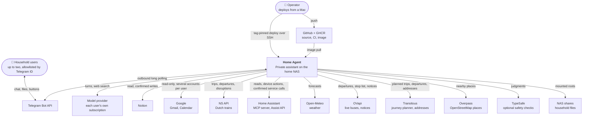
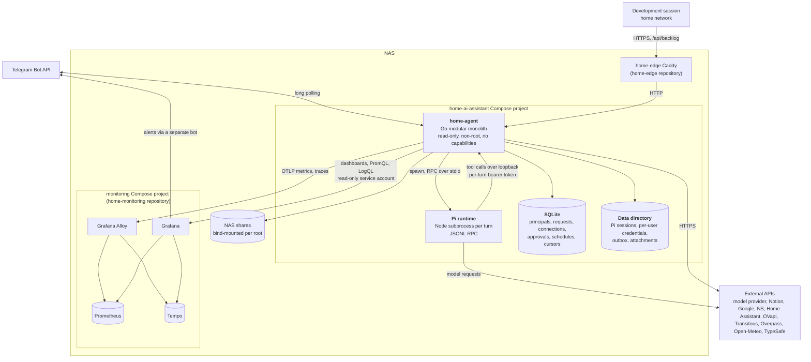

# Architecture

The diagrams follow the [C4 model](https://c4model.com): system context, then
containers, then the components inside the Go application. They describe what is
built; see [plans](plans/README.md) for how each part came to be.

## 1. System context

Nothing listens on the internet. Telegram is polled outbound, every integration is
an outbound HTTPS client, and administrative interfaces stay on the LAN.

## 2. Containers

| Container | Responsibility |
| --- | --- |
| `home-agent` | Everything with authority: identity, policy, tools, credentials, approvals, scheduling, delivery, telemetry |
| Pi runtime | The model loop only. It gets no built-in tools, skills, or project context; its tools are the bridge extension that calls back into `home-agent` |
| SQLite | Durable control-plane state through `modernc.org/sqlite` (pure Go, no CGO) |
| Data directory | Mode `0700`; Pi session history, per-user integration credentials, and pending day cards |
| Monitoring | Separate repository and Compose project, joined through a private Docker network |

## 3. Components of `home-agent`

```mermaid
flowchart TB
    tg["<b>telegram</b><br/>poller, commands, /settings,<br/>media, markup"]
    identity["<b>identity</b><br/>Telegram ID → principal"]
    conv["<b>conversation</b><br/>per-principal turn coordinator"]
    runtime["<b>runtime / runtime/pi</b><br/>AgentRuntime, Pi process,<br/>bridge extension"]
    connection["<b>connection</b><br/>per-user model subscription"]
    broker["<b>tools</b><br/>broker: grants, budgets,<br/>untrusted-result marking"]
    approval["<b>approval</b><br/>Confirm / Reject proposals,<br/>exactly-once execution"]
    schedule["<b>schedule</b><br/>durable jobs, reminders,<br/>scheduled model turns"]
    task["<b>task</b><br/>background sub-agents<br/>beside the chat"]
    watch["<b>watch</b><br/>windowed checks in code<br/>or model turns, alerts on change"]
    routes["<b>routes</b><br/>saved journeys,<br/>checked leg by leg in code"]
    judgment["<b>judgment</b><br/>TypeSafe screening, intent checks,<br/>tool hints (opt-in)"]
    searchcheck["<b>searchcheck</b><br/>per-query web search checks"]
    integration["<b>integration</b><br/>per-user enable / disable"]
    loc["<b>location</b><br/>latest shared position, expiry"]
    mem["<b>memory</b><br/>per-user instructions and facts"]
    backlog["<b>backlog</b><br/>per-user ideas for developing<br/>the assistant"]
    attach["<b>attachment</b><br/>inbound photos and files"]
    delivery["<b>delivery</b><br/>outbound files"]
    card["<b>daycard / outbox</b><br/>rendered day cards"]
    pdf["<b>pdftext</b>"]
    api["<b>HTTP</b><br/>health, backlog API"]

    subgraph connectors["connectors"]
        notion["notion"]
        google["google<br/>accounts, grants"]
        gmail["gmail"]
        calendar["calendar"]
        nasc["nas"]
        nsc["ns"]
        hac["homeassistant<br/>MCP tools, history, confirmed calls"]
        grafanac["grafana<br/>dashboards, metrics, logs"]
        busc["bus"]
        web["web<br/>pages, weather"]
        placesc["places<br/>nearby places, addresses"]
    end

    store[("<b>store/sqlite</b><br/>migrations")]
    obs["<b>observability</b><br/>OpenTelemetry"]
    module["<b>module</b><br/>registry, lifecycle, readiness"]

    tg --> identity
    tg --> conv
    tg --> connection
    tg --> integration
    tg --> approval
    tg --> loc
    tg --> mem
    conv --> loc
    conv --> mem
    broker --> mem
    approval --> mem
    tg --> backlog
    broker --> backlog
    approval --> backlog
    api --> backlog
    loc --> placesc
    conv --> runtime
    conv --> broker
    conv --> card
    conv --> judgment
    conv --> searchcheck
    searchcheck --> approval
    searchcheck --> judgment
    runtime --> connection
    broker --> connectors
    broker --> attach
    broker --> schedule
    broker --> judgment
    approval --> connectors
    approval --> schedule
    schedule --> conv
    tg --> task
    broker --> task
    task --> conv
    task --> store
    tg --> watch
    broker --> watch
    approval --> watch
    watch --> store
    watch --> nsc
    watch --> busc
    watch --> hac
    watch --> conv
    tg --> routes
    broker --> routes
    approval --> routes
    routes --> nsc & busc & store
    nasc --> delivery
    web --> pdf
    connectors --> integration
    identity & conv & approval & schedule & connection & integration & loc & mem & backlog --> store
```

`internal/app` wires these together. Each connector registers with the module
registry (lifecycle and readiness), the tool broker (the tools it offers), and, if
it can write, the approval service (the executor for confirmed proposals).

Every external HTTP client except Telegram and the model-connection flow wraps its
transport in `internal/httpretry`, which retries transient failures: at most 4
attempts within 5 s of the first, full-jitter exponential backoff, never past the
request's deadline, and `Retry-After` honored when it fits. Reads are retried; a
POST is retried only when its call site marks it idempotent (read-only queries) or
the connection never opened. The web connector's transport sits inside its address
guard, so each attempt is checked again. The `home_agent.http.retries` counter
records retried requests by service and outcome (recovered, exhausted,
not_retryable), and each retry is logged at debug level.

### A conversation turn

1. `telegram` receives an update, `identity` resolves the sender to a principal, and
   anything from an unknown user or a non-private chat is dropped.
2. The request is persisted before the polling cursor advances, so a restart never
   loses or replays an accepted message.
3. `conversation` claims it, resolves the principal's own model connection, and
   collects only the tools that principal has granted and enabled. From the wait
   for the principal's turn slot until the turn ends, typing is resent every 4
   seconds; a turn running longer than 8 seconds also shows a Telegram draft such
   as "Searching the web… · 40s", refreshed every 20 seconds, named from the
   activity key of the connector whose tool is running and never from arguments
   or results. The keys stay out of what the model sees. The draft's stop button
   cancels that turn like `/cancel`; a press for an older draft changes nothing.
   Both are best effort: a failed call is counted and skipped, and both stop
   before the turn ends, so neither lands after the reply.
4. `runtime/pi` starts Pi with a private per-turn directory containing the bridge
   extension and those tool definitions.
5. Every tool call returns over loopback to `tools`, which rechecks the grant and
   bounds it to 15 seconds, 16 KiB, and 8 calls per turn.
6. A write becomes a proposal; `approval` sends Confirm and Reject after the reply
   and executes a confirmed proposal once. A turn's proposals (up to ten) form one
   bundle; a long one is sent as several messages, each item whole in one of them
   and the buttons on the last, which is the only one edited with the outcome.
   A bundle with a new or changed scheduled prompt also gets Preview, which runs
   each such prompt once through the scheduled-run path, one preview per bundle at
   a time, and posts the report under the proposal without storing a job or a run.
   The model can withdraw items still waiting with `proposal_withdraw`; they end
   rejected as withdrawn, the message shows them so, and it loses its buttons once
   nothing is left.
   A Confirm that ran the actions queues a
   turn that continues the request from their outcome, so a dependent next step
   needs no nudge; it stays silent when nothing is left to do.
7. The reply goes back through Telegram, as a day card photo with a caption when the
   turn produced one. Message bodies are then cleared from SQLite; the sent
   message's ID is kept with its session, so replying to it later returns to
   that conversation. A turn answering a message the user wrote, not the
   continuation after Confirm, can also set one emoji reaction on that message
   with `react`; when the reaction is the whole answer the turn replies
   `[nothing-to-add]`, and delivery sends no text, not even the line marking a
   resumed conversation, but still sends the turn's proposals. Such a turn whose
   reply is only emoji sends no text either: its first emoji, when it is one the
   tool may set, becomes the reaction, or the reply is dropped when the turn
   already reacted. `home_agent.reactions.sent` counts the reactions by emoji
   and `home_agent.reactions.converted` the replies turned into one.
   The user's own reactions to their recorded replies, in their private chat,
   are kept as feedback: only the latest class (positive, negative, or other) and
   emoji per message, never the text, and removing the reaction removes it. The
   first 👎 on a reply, whichever of its messages it lands on, queues one turn in
   that reply's conversation, returning to it if it was closed, with a fixed
   message naming when the reply was sent and asking the model to look at it
   again, quoting the reply in Telegram; like the turn after
   Confirm, its message is ours, so it offers no `react`, starts no tool hint, and
   is not the request actions are judged against. The turn is queued under the
   reaction's Telegram update before the reply is marked as reconsidered, so a
   redelivered update cannot queue two; a 👎 while a turn is pending is kept
   without marking it and sends nothing. `home_agent.reactions.received` counts
   reactions by class and `home_agent.reactions.reconsiders` the reconsider turns
   by outcome.
   While the user has memory and "Learn from 👎" on, the reconsider message adds
   a second step: when the mistake would recur because of a preference, a habit,
   or a rule, propose one memory instruction. The run is marked as a reconsider,
   so the memory tools label that proposal "Learned from your 👎", with the
   reply's date when known and not when the conversation read outside
   content, refuse a second one in the same turn, and refuse any while learning is off;
   a confirmed lesson is kept with source `learned`. `home_agent.memory.lessons`
   counts lessons proposed and written.

### Earlier conversations

Each principal has one active conversation session; `/new` closes it, and
`/sessions` or a reply to an earlier answer reactivates a closed one, whose Pi
session file the next turn resumes. Pi's session files are the only copy of the
history: titles in `/sessions` and the model's `conversation_search` and
`conversation_read` tools read the principal's own files on demand, user and
assistant text only, and nothing is indexed or copied into SQLite. A restart
during a turn keeps the session, since Pi resumes a file that ends in an
unanswered message. Chat session files are kept; the files of scheduled runs and
finished tasks, which no conversation refers to, are deleted 30 days after they
were last written.

### Scheduled jobs in conversation

The system prompt of chat turns and background tasks ends, after memory, with the
principal's enabled jobs and pending reminders: ID, name, schedule, and the first
800 runes of the instructions, newest first and capped at 10000 runes. It changes
only when a job is added, changed, paused, or finished, so the prompt stays
cacheable; scheduled turns carry their own prompt instead. Each delivered report of
a job or reminder is kept in SQLite for 14 days, at most 200 per principal, with
the Telegram messages it was sent as. The next chat turn gets a one-line excerpt
of each report no turn has heard of, the first turn of a conversation those of the
last day, and a reply to a report's message that report in full; the
`job_reports` read tool lists and reads them. Every lookup is keyed by principal.
A report counts as outside content, and one whose run read private content makes
the conversation private.

### A background task

A request that needs many lookups is handed by the model to `task_start`, which
is outside the turn's 8-call budget. `task` stores the task with its own Pi session
and posts a status message with a Cancel button. One worker per principal runs it
through `conversation` as a second Pi process beside the chat, without the
principal's turn slot, with read tools only and its own time, tool, and model-call
budgets. A task that reaches a limit is asked once, briefly, to report what it has.
The report goes out as a reply to the request, and the next chat turn learns of it.
A restart resumes a running task in its session; a second interruption fails it.

### A watch

A watch is a confirmed, per-user definition: a train or bus departure, a saved
route, or a set of stations, with weekdays or one date, a daily window (by default
90 minutes before the departure until it), the triggers, and a delay threshold.
The `watch` module runs its own loop, apart from the scheduler, because most checks
are code rather than model turns. Inside the window it checks every 5 minutes, every 2
in the last 30, through the evaluator registered for the watch's kind, and compares
the normalized state with the one stored for that day's window. A change into a
triggering state queues an alert; a later change out of it queues "back to normal";
three failed checks in a row queue one notice; a window sends at most five
messages. State and alert are written in one transaction. Alerts go from `ready` to
`delivered` like scheduled runs, are retried on transient Telegram failures, and are
dropped once their window ends or the watch is paused or muted. Identical upstream
queries within one cycle share one answer.

A watch may carry a language, which the model proposing it fills with the language
of the conversation. Its messages are still written by code in English; at delivery
one model call on the owner's own subscription, with no tools, memory, or web
search, a fresh session, and no turn slot, rewrites the message into that language.
The rewrite is sent only when it fits one message and keeps every number of the
English text; otherwise, or when the call fails or takes over 30 seconds, the
English text is sent. The next conversation turn hears the text that was sent.

Departure, route, disruption, and home watches are checked; a kind is offered only when its
connector is configured, and every check runs under the owner's own trains or
buses switch, so a user with that switch off can neither propose nor run one.
Proposing resolves the stations or stop for the owner and stores full station
names. A departure watch checks its one planned departure through the NS or bus
departure check and alerts with the same status phrase: a delay under the
threshold counts as on time, and above it changes state only every 5 more
minutes; a departure no longer in the timetable always alerts, and a failed check
counts as an upstream failure. A disruption watch asks NS per station for what is
in effect now and at the end of its window, and alerts on an entry that is new or
whose title, situation, advice, or expected end changed; one of several ending is
silent. A route watch resolves the route name against the owner's saved routes
(case-insensitive, stored under the saved name) and checks it with
`routes.Service.Check`, once per cycle per route and day. Its state is each
train or bus leg's departure in the route (a delay in steps as above, a platform
change, or no departure left to take) plus whether the arrival target is missed,
and its alert carries the route check's own leg lines. The check fails as an upstream
failure only when every train and bus leg failed, and as a plain error when the
route has been deleted; either ends in the usual failure notice.

An agent watch checks anything the assistant can look at with a model turn instead of
code. It has a short name, an instruction (what to look at and how), a condition (when
to tell the user), an interval of 30 to 1440 minutes, and an optional last day after
which it is deleted; each user may keep five. The service polls the kind every
minute, and its evaluator decides when a check is due. A check is an unwatched turn
like a scheduled run: the owner's own subscription, a fresh session, read-only tools
with web search when the owner has it on, and memory, but no turn slot, so a chat
turn never waits behind it, as with a background task. It runs
in the background, at most one per user and two in all, so it never holds back the
code-checked watches of the same cycle: `Evaluate` starts it and skips, and the
first `Evaluate` after it finishes returns what it found, unless the watch was edited
meanwhile. The turn's message carries the instruction, the condition, the value last
reported, and the local time, and the reply must end with a JSON verdict (`met`,
`value`, `headline`, `details`, or `error`); a reply without one, an `error`, or a
failed turn is a failed check. The state is `met` or `unmet` with the normalized
value: a new value is stored silently unless the condition holds and the watch
alerts on a change, and a new window starts from the previous one's state and last
check, so a condition that keeps holding is not reported again at midnight. Its
alerts were written by a model that read web pages or mail, so they reach the next
turn as outside content, and as private when the check read private content.

A home watch waits for a Home Assistant entity to be in a state, or above or below a
number, optionally for some minutes, and checks every minute all day by default. Its
evaluator lives in the `homeassistant` connector: proposing resolves a friendly name
to exactly one entity ID among those the assistant can see (exposed to Assist or
labelled `assistant-confirm`), and each check reads `/api/states` once per cycle for
all home watches, fails when the entity is no longer visible in the 5-minute snapshot
or reports `unavailable` or `unknown`, and skips quietly while the owner's Home
switch is off. The service stores when the condition started holding; a state
condition is seeded from the entity's `last_changed`, a numeric one from the first
check that saw it hold.

### App help

`telegram` offers `app_help` on every turn: for a topic, the `/settings` page of an
integration rendered for that principal with its buttons and the messages they
send, the command list, `/jobs`, or how web search is checked. The text comes from
the same rendering and strings as the pages themselves, so the model's setup
instructions cannot drift from the app. Turns therefore always carry the tool
bridge; web search is still offered only while the principal's web access is on, and its extension asks the bridge to check each query.

### Departure checks

`ns_trips` with `departures`, and `bus_stop_status` with `departure`, check the
exact planned departures a user names. NS is asked for trips from each planned
minute, and only a trip whose first train leaves the origin at exactly that
minute counts; a cancelled train NS leaves out of its plans is looked up on the
station's departure board. A bus is matched by stop, minute, line, and optionally
direction, live from OVapi within the next hour and otherwise from the
Transitous timetable. A departure that is not found is reported as not in the
timetable, and nearby trains or buses are never put in its place. Each result
carries one status from `internal/transit` (on time, delayed +N min, cancelled,
partly cancelled, changed platform N, not in the timetable, or check failed),
which replies copy word for word. `ns.Service.CheckDepartures`,
`bus.Service.CheckDepartures`, and `ns.Service.Disruptions` expose the same
checks to Go callers.

### A saved route

A route is a confirmed, per-user record in `routes`: a name, the weekdays it
applies to, an optional arrival target, and up to eight legs stored as checked
JSON. A walk or bike leg has the minutes the user stated; a train leg has from,
to, an optional via, and fixed planned departures; a bus leg has a stop, a line,
an optional direction, fixed departures, and optional ride minutes. The tools
refuse a missing number instead of choosing one, and station and stop names are
looked up through the NS and bus connectors when a leg is proposed, so the stored
names are the ones the checks find again. `route_save`, `route_update` (named
fields or one leg by number), and `route_remove` are confirmed like other writes,
and an update's summary shows only what changes. `route_check` is code: for a day,
the named route or the one whose weekdays include that day, it runs the departure
checks for each train and bus leg, takes the first departure that runs and leaves
no earlier than the previous leg ends, adds the walk and bike minutes without any
buffer, and returns one block per leg with its status, then whether the arrival
target is met and which legs failed to check. It is one tool call, and
`routes.Service.Check` returns the same result to Go callers. `/jobs` lists the
routes after jobs and watches, read-only, with a Delete button each.

## Security model

- **Identity before anything.** Only allowlisted numeric Telegram IDs in private
  chats reach the application; every request resolves to a principal first.
- **Per-user model subscriptions.** Each user connects their own subscription
  through `/settings`. There is no shared or fallback credential. Voice
  transcription and image generation reach the ChatGPT backend from Go with
  the same per-user login, refreshed under Pi's lock on `auth.json`.
- **Per-user integrations.** Credentials live under
  `data/integrations/<principal>/` with mode `0600`. Each user enables and disables
  each integration independently.
- **Authority stays in Go.** Grants, budgets, approvals, and credentials are
  enforced by the application, never by prompt instructions. Pi inherits a minimal
  environment without the Telegram token. A call that ends in an error gives its
  budget slot back, and a ceiling of twice the budget, failed calls included,
  still bounds a turn.
- **Read first, confirm writes.** Writes to Notion, the NAS, and schedules are
  off until the user turns them on and are always confirmed per action. A
  reminder is set and cancelled without confirmation, since it only sends its
  owner's own text to their own chat, and scheduled turns cannot set one. Background
  tasks start without confirmation too: they only spend the owner's own
  subscription on read-only work and cannot start another task. The
  other exception is Home Assistant: everyday actions on devices exposed to Assist run
  without confirmation and are not offered in scheduled turns; sensitive ones
  (labelled `assistant-confirm`, or locks, alarm panels, valves, sirens, cameras,
  firmware updates, and garage, gate, or door covers) are confirmed per action. If
  such a device is exposed, all immediate actions are withheld and reads remain.
  Reminders, tasks, and everyday home actions need Confirm after outside content
  (below).
- **Outside content turns actions into proposals.** Once a conversation has read
  text written outside the household, such as a web page, an email, a calendar
  invite, log lines, or a background task's report, it stays marked until `/new`.
  Text from the household's own devices through Home Assistant does not count.
  In a marked conversation, or a run that has read such text:
  - home actions, `reminder_set`, and `task_start` are proposed for Confirm;
  - `fetch_page` opens only addresses from the user's message or from what the
    run has read;
  - each web search query is checked before it is sent (below).
  The extension's `urls` argument and URL context tool are removed, so the model
  cannot hand an address to the search provider.
- **Web search is checked per query.** The provider's search can open an address
  the query names, and a search cannot be stopped once it starts, so after
  outside content a query could carry data out. The vendored extension therefore
  asks the application before every search: it posts the query to a
  `/search-check` endpoint on the turn's tool bridge, under the turn's bearer
  token, and searches only when the answer is `allow`. A missing endpoint, a
  failed or slow request, or a malformed answer means no search, and a turn
  without a check refuses every query. The `searchcheck` package decides, in
  order:
  1. a run or conversation that has read no outside content: `allow`;
  2. a query the user confirmed in the last 30 minutes, once: `allow`;
  3. a principal marked suspicious by screening, who opted in to safety checks:
     `confirm`;
  4. a query holding what the TypeSafe redactor would change (an address, email
     address, phone, card, or IBAN number, IP address, path, token, or encoded
     blob), a bare host name, a site-naming search operator, or more than 500
     characters: `confirm`. These detectors need no TypeSafe key;
  5. for principals who opted in, a Jev question over the redacted query and the
     user's recent messages, whether the search serves the request, below 0.3:
     `confirm`. A TypeSafe failure falls through to the next step;
  6. otherwise `allow`.
  `confirm` proposes a `web_search` approval, "Search the web for: ...", with the
  reason; the model is told the search did not run and waits. After Confirm the
  continuation turn searches again with the same query. Scheduled runs and
  background tasks have nobody to ask, so `confirm` becomes `deny` there. Plain
  words can still describe private facts; without an address the query has
  nowhere to go but the provider's own search, which is accepted. Pages the
  provider's search opens by itself are chosen by the search engine and are not
  covered. The `home_agent.search.checks` counter records each decision by
  verdict and reason.
- **Safety checks.** A user who opts in has scrubbed text sent to TypeSafe: web
  pages and emails the assistant reads, proposed actions, and the recent
  exchange. The exchange is the user's last two messages and the assistant's
  latest chat reply within 30 minutes. The reply is recorded only after its own
  turn's approval cards were checked, so a reply never vouches for the action it
  proposes. Replies are not recorded from a conversation that has read Notion
  content or NAS file contents (`tools.Definition.Private`), which stays marked
  until `/new`. Exposure that makes the intent check stricter comes from chat
  turns only; a scheduled run counts only when screening flags its content. The
  tool hint reads the same exchange, and is skipped on the continuation after
  Confirm.
- **Home Assistant scope.** One household token from a dedicated non-admin Home
  Assistant user. Only entities exposed to Assist are reachable by the MCP tools;
  the tool, exposure, and label snapshot is cached for 5 minutes.
- **Grafana scope.** One Viewer service-account token, offered only to the
  principals in `HOME_AGENT_GRAFANA_PRINCIPALS`. Queries go through Grafana's
  data source proxy and are bounded in range, resolution, series, and lines.
- **Untrusted input.** Tool results, web pages, email, and model output are marked
  and treated as data. Private and loopback addresses are refused by the web tools.
- **NAS isolation by mount.** Only inbox and shared-drop paths are mounted
  writable; the per-principal roots file decides which user sees which folders.
- **Quiet telemetry.** Logs and traces carry principal IDs, tool names, outcomes,
  and sizes, never message text, usernames, tokens, or locations.
- **Memory.** Each principal's instructions and facts live in SQLite, are capped
  in size, and are rendered into the system prompt of that principal's turns
  only. The model writes them through tools offered in chat turns alone; an
  instruction, and any write in a conversation that has read third-party
  content, including a web search, needs Confirm.
  Every write is shown in the reply, and `/memory` deletes any entry. Only the
  turn a 👎 starts writes `learned` entries, one proposal at most, and each still
  needs Confirm.
- **Backlog.** Each principal's ideas for developing the assistant live in
  SQLite, apart from memory, and never reach the prompt; the model reads them
  only through `backlog_list`. The tools are offered in chat turns alone, and a
  write in a conversation that has read text from outside the household needs
  Confirm, because an exported item is pasted into a development session.
  `/api/backlog` serves every principal's open items, one item by ID, and
  marking one done, without authentication: the home-edge Caddy exposes only
  `/api/*` to the home network, and the API cannot add, edit, or delete items.
- **Short-lived location.** Only each user's latest shared position is stored. It is
  used while fresh, then deleted by a prune with SQLite `secure_delete` on; a user
  forgets it at once from `/settings`, and a forgotten live share stays ignored.

## Key decisions

| Decision | Why |
| --- | --- |
| Telegram with outbound long polling | Stable identities, files, and buttons without a frontend or public ingress |
| Go modular monolith, statically compiled modules enabled by configuration | Small footprint on the NAS and an explicit trust boundary |
| Pi behind the `AgentRuntime` interface | Reuses a subscription-capable harness without locking the core to it |
| Application-owned tools, policy, approvals, and scheduler | These controls cannot be delegated to a prompt or to the harness |
| SQLite through a pure-Go driver | One instance and two users need no database server; no CGO |
| Direct APIs rather than MCP | Fewer layers; MCP only where it adds concrete value |
| Native source search rather than RAG | Every source already has search; no evidence an index is needed |
| OpenTelemetry → Alloy → Prometheus and Tempo, Grafana on top | Metrics and traces from day one within the NAS memory budget |
| Tag-pinned manual deploys; CI builds the image but has no NAS access | The operator stays the only path to production, and each deploy records its digest |
| Secrets in macOS Keychain, only the needed copies on the NAS | Recovery stays with the operator; secrets stay out of Git, CI, images, and env values |

Not built: photo-library, network-controller, and GitHub connectors; local
inference; RAG.
