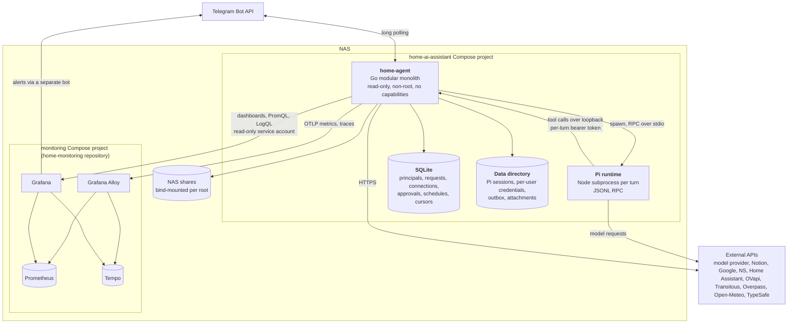

# Architecture

The diagrams follow the [C4 model](https://c4model.com): system context, then
containers, then the components inside the Go application. They describe what is
built; see [plans](plans/README.md) for how each part came to be.

## 1. System context

Nothing listens on the internet. Telegram is polled outbound, every integration is
an outbound HTTPS client, and administrative interfaces stay on the LAN.

## 2. Containers

| Container | Responsibility |
| --- | --- |
| `home-agent` | Everything with authority: identity, policy, tools, credentials, approvals, scheduling, delivery, telemetry |
| Pi runtime | The model loop only. It gets no built-in tools, skills, or project context; its tools are the bridge extension that calls back into `home-agent` |
| SQLite | Durable control-plane state through `modernc.org/sqlite` (pure Go, no CGO) |
| Data directory | Mode `0700`; Pi session history, per-user integration credentials, and pending day cards |
| Monitoring | Separate repository and Compose project, joined through a private Docker network |

## 3. Components of `home-agent`

```mermaid
flowchart TB
    tg["<b>telegram</b><br/>poller, commands, /settings,<br/>media, markup"]
    identity["<b>identity</b><br/>Telegram ID → principal"]
    conv["<b>conversation</b><br/>per-principal turn coordinator"]
    runtime["<b>runtime / runtime/pi</b><br/>AgentRuntime, Pi process,<br/>bridge extension"]
    connection["<b>connection</b><br/>per-user model subscription"]
    broker["<b>tools</b><br/>broker: grants, budgets,<br/>untrusted-result marking"]
    approval["<b>approval</b><br/>Confirm / Reject proposals,<br/>exactly-once execution"]
    schedule["<b>schedule</b><br/>durable jobs, reminders,<br/>scheduled model turns"]
    task["<b>task</b><br/>background sub-agents<br/>beside the chat"]
    judgment["<b>judgment</b><br/>TypeSafe screening, intent checks,<br/>tool hints (opt-in)"]
    integration["<b>integration</b><br/>per-user enable / disable"]
    loc["<b>location</b><br/>latest shared position, expiry"]
    mem["<b>memory</b><br/>per-user instructions and facts"]
    attach["<b>attachment</b><br/>inbound photos and files"]
    delivery["<b>delivery</b><br/>outbound files"]
    card["<b>daycard / outbox</b><br/>rendered day cards"]
    pdf["<b>pdftext</b>"]

    subgraph connectors["connectors"]
        notion["notion"]
        google["google<br/>accounts, grants"]
        gmail["gmail"]
        calendar["calendar"]
        nasc["nas"]
        nsc["ns"]
        hac["homeassistant<br/>MCP tools, history, confirmed calls"]
        grafanac["grafana<br/>dashboards, metrics, logs"]
        busc["bus"]
        web["web<br/>pages, weather"]
        placesc["places<br/>nearby places, addresses"]
    end

    store[("<b>store/sqlite</b><br/>migrations")]
    obs["<b>observability</b><br/>OpenTelemetry"]
    module["<b>module</b><br/>registry, lifecycle, readiness"]

    tg --> identity
    tg --> conv
    tg --> connection
    tg --> integration
    tg --> approval
    tg --> loc
    tg --> mem
    conv --> loc
    conv --> mem
    broker --> mem
    approval --> mem
    loc --> placesc
    conv --> runtime
    conv --> broker
    conv --> card
    conv --> judgment
    runtime --> connection
    broker --> connectors
    broker --> attach
    broker --> schedule
    broker --> judgment
    approval --> connectors
    approval --> schedule
    schedule --> conv
    tg --> task
    broker --> task
    task --> conv
    task --> store
    nasc --> delivery
    web --> pdf
    connectors --> integration
    identity & conv & approval & schedule & connection & integration & loc & mem --> store
```

`internal/app` wires these together. Each connector registers with the module
registry (lifecycle and readiness), the tool broker (the tools it offers), and, if
it can write, the approval service (the executor for confirmed proposals).

### A conversation turn

1. `telegram` receives an update, `identity` resolves the sender to a principal, and
   anything from an unknown user or a non-private chat is dropped.
2. The request is persisted before the polling cursor advances, so a restart never
   loses or replays an accepted message.
3. `conversation` claims it, resolves the principal's own model connection, and
   collects only the tools that principal has granted and enabled.
4. `runtime/pi` starts Pi with a private per-turn directory containing the bridge
   extension and those tool definitions.
5. Every tool call returns over loopback to `tools`, which rechecks the grant and
   bounds it to 15 seconds, 16 KiB, and 8 calls per turn.
6. A write becomes a proposal; `approval` sends Confirm and Reject after the reply
   and executes a confirmed proposal once. A Confirm that ran the actions queues a
   turn that continues the request from their outcome, so a dependent next step
   needs no nudge; it stays silent when nothing is left to do.
7. The reply goes back through Telegram, as a day card photo with a caption when the
   turn produced one. Message bodies are then cleared from SQLite; the sent
   message's ID is kept with its session, so replying to it later returns to
   that conversation.

### Earlier conversations

Each principal has one active conversation session; `/new` closes it, and
`/sessions` or a reply to an earlier answer reactivates a closed one, whose Pi
session file the next turn resumes. Pi's session files are the only copy of the
history: titles in `/sessions` and the model's `conversation_search` and
`conversation_read` tools read the principal's own files on demand, user and
assistant text only, and nothing is indexed or copied into SQLite. A restart
during a turn keeps the session, since Pi resumes a file that ends in an
unanswered message. Chat session files are kept; the files of scheduled runs and
finished tasks, which no conversation refers to, are deleted 30 days after they
were last written.

### A background task

A request that needs many lookups is handed by the model to `task_start`, which
is outside the turn's 8-call budget. `task` stores the task with its own Pi session
and posts a status message with a Cancel button. One worker per principal runs it
through `conversation` as a second Pi process beside the chat, without the
principal's turn slot, with read tools only and its own time, tool, and model-call
budgets. A task that reaches a limit is asked once, briefly, to report what it has.
The report goes out as a reply to the request, and the next chat turn learns of it.
A restart resumes a running task in its session; a second interruption fails it.

## Security model

- **Identity before anything.** Only allowlisted numeric Telegram IDs in private
  chats reach the application; every request resolves to a principal first.
- **Per-user model subscriptions.** Each user connects their own subscription
  through `/settings`. There is no shared or fallback credential.
- **Per-user integrations.** Credentials live under
  `data/integrations/<principal>/` with mode `0600`. Each user enables and disables
  each integration independently.
- **Authority stays in Go.** Grants, budgets, approvals, and credentials are
  enforced by the application, never by prompt instructions. Pi inherits a minimal
  environment without the Telegram token. A call that ends in an error gives its
  budget slot back, and a ceiling of twice the budget, failed calls included,
  still bounds a turn.
- **Read first, confirm writes.** Writes to Notion, the NAS, and schedules are
  off until the user turns them on and are always confirmed per action. A
  reminder is set and cancelled without confirmation, since it only sends its
  owner's own text to their own chat, and scheduled turns cannot set one. Background
  tasks start without confirmation too: they only spend the owner's own
  subscription on read-only work and cannot start another task. The
  other exception is Home Assistant: everyday actions on devices exposed to Assist run
  without confirmation and are not offered in scheduled turns; sensitive ones
  (labelled `assistant-confirm`, or locks, alarm panels, valves, sirens, cameras,
  firmware updates, and garage, gate, or door covers) are confirmed per action. If
  such a device is exposed, all immediate actions are withheld and reads remain.
  Reminders, tasks, and everyday home actions need Confirm after outside content
  (below).
- **Outside content turns actions into proposals.** Once a conversation has read
  text written outside the household, such as a web page, an email, a calendar
  invite, log lines, or a background task's report, it stays marked until `/new`.
  Text from the household's own devices through Home Assistant does not count.
  In a marked conversation, or a run that has read such text:
  - home actions, `reminder_set`, and `task_start` are proposed for Confirm;
  - `fetch_page` opens only addresses from the user's message or from what the
    run has read;
  - chat turns run without web search, because the provider's search can open
    an address the query names.
  The extension's `urls` argument and URL context tool are removed, so the model
  cannot hand an address to the search provider.
- **Home Assistant scope.** One household token from a dedicated non-admin Home
  Assistant user. Only entities exposed to Assist are reachable by the MCP tools;
  the tool, exposure, and label snapshot is cached for 5 minutes.
- **Grafana scope.** One Viewer service-account token, offered only to the
  principals in `HOME_AGENT_GRAFANA_PRINCIPALS`. Queries go through Grafana's
  data source proxy and are bounded in range, resolution, series, and lines.
- **Untrusted input.** Tool results, web pages, email, and model output are marked
  and treated as data. Private and loopback addresses are refused by the web tools.
- **NAS isolation by mount.** Only inbox and shared-drop paths are mounted
  writable; the per-principal roots file decides which user sees which folders.
- **Quiet telemetry.** Logs and traces carry principal IDs, tool names, outcomes,
  and sizes, never message text, usernames, tokens, or locations.
- **Memory.** Each principal's instructions and facts live in SQLite, are capped
  in size, and are rendered into the system prompt of that principal's turns
  only. The model writes them through tools offered in chat turns alone; an
  instruction, and any write in a conversation that has read third-party
  content, including a web search, needs Confirm.
  Every write is shown in the reply, and `/memory` deletes any entry.
- **Short-lived location.** Only each user's latest shared position is stored. It is
  used while fresh, then deleted by a prune with SQLite `secure_delete` on; a user
  forgets it at once from `/settings`, and a forgotten live share stays ignored.

## Key decisions

| Decision | Why |
| --- | --- |
| Telegram with outbound long polling | Stable identities, files, and buttons without a frontend or public ingress |
| Go modular monolith, statically compiled modules enabled by configuration | Small footprint on the NAS and an explicit trust boundary |
| Pi behind the `AgentRuntime` interface | Reuses a subscription-capable harness without locking the core to it |
| Application-owned tools, policy, approvals, and scheduler | These controls cannot be delegated to a prompt or to the harness |
| SQLite through a pure-Go driver | One instance and two users need no database server; no CGO |
| Direct APIs rather than MCP | Fewer layers; MCP only where it adds concrete value |
| Native source search rather than RAG | Every source already has search; no evidence an index is needed |
| OpenTelemetry → Alloy → Prometheus and Tempo, Grafana on top | Metrics and traces from day one within the NAS memory budget |
| Tag-pinned manual deploys; CI builds the image but has no NAS access | The operator stays the only path to production, and each deploy records its digest |
| Secrets in macOS Keychain, only the needed copies on the NAS | Recovery stays with the operator; secrets stay out of Git, CI, images, and env values |

Not built: photo-library, network-controller, and GitHub connectors; local
inference; RAG.
