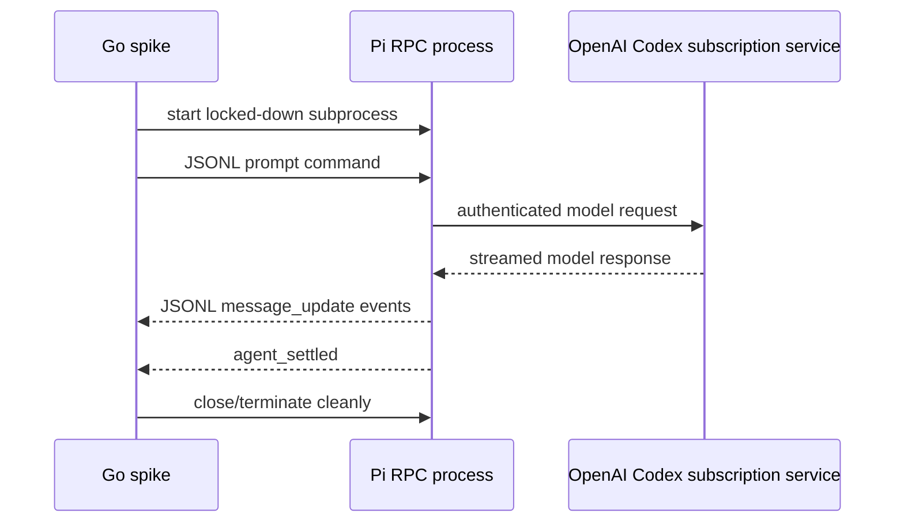

# Pi OpenAI Subscription from Go

## Status

Verified locally on 2026-08-30. Two independent Go-driven RPC runs succeeded
after the interactive Pi client had exited.

## Question

Can a Go application launch Pi as a locked-down headless subprocess, use Pi’s
`openai-codex` provider authenticated through the owner’s ChatGPT subscription,
send a prompt over JSONL RPC, and receive a streamed response without an OpenAI
API key?

## Why this matters

The preferred application language is Go, while Pi’s embedded SDK is
TypeScript. A subprocess RPC boundary could retain Pi’s agent-runtime mechanics
without making the entire application TypeScript or adding a custom Go model
loop.

The result does not automatically prove that one subscription may serve both
household users or that the setup is appropriate for unattended production.
Those are separate lifecycle and intended-use questions.

## Evidence before testing

Official OpenAI documentation states that local Codex supports two sign-in
methods:

- ChatGPT sign-in for subscription access;
- API key sign-in for usage-based access.

It also documents managed browser and device-code login through Codex App Server.
This establishes that subscription-backed local programmatic clients are a
supported OpenAI concept, although this experiment uses Pi’s provider rather
than Codex App Server directly.

Sources:

- [OpenAI authentication](https://learn.chatgpt.com/docs/auth)
- [Codex App Server](https://learn.chatgpt.com/docs/app-server)

Pi’s current documentation states:

- ChatGPT Plus/Pro is available through the `openai-codex` OAuth provider;
- credentials are stored under `~/.pi/agent/auth.json` and refreshed;
- RPC mode is intended for other-language integration;
- commands and events use strict newline-delimited JSON over stdin/stdout.

Sources:

- [Pi provider documentation](https://github.com/earendil-works/pi/blob/main/packages/coding-agent/docs/providers.md)
- [Pi RPC documentation](https://github.com/earendil-works/pi/blob/main/packages/coding-agent/docs/rpc.md)

## Local baseline

Observed during the experiment:

| Item | State |
| --- | --- |
| Pi | Installed, version `0.84.1` |
| Node.js | Installed, version `v24.19.0` |
| Go | Installed through Homebrew, version `go1.27.0 darwin/arm64` |
| Pi `openai-codex` auth before login | `not_ready`, credentials not configured |
| Pi `openai-codex` auth after login | `ready`, OAuth |
| Selected model | `openai-codex/gpt-5.5` |
| Project Git state | Directory is not currently a Git repository |

No credential value was printed. Readiness was checked with:

```sh
pi auth check --provider openai-codex --json --no-refresh
```

## Verified process



## Lockdown

The spike launches Pi with:

```text
--mode rpc
--provider openai-codex
--no-session
--no-tools
--no-extensions
--no-skills
--no-prompt-templates
--no-themes
--no-context-files
--no-approve
```

It uses an explicit benign working directory and a fixed prompt. It does not
load project instructions, files, extensions, or tool definitions.

## Success criteria

1. Pi authentication readiness reports `ready` for `openai-codex` without an
   `OPENAI_API_KEY`.
2. Go starts Pi and sends a valid RPC prompt.
3. Go receives the prompt acknowledgement and streaming text events.
4. Pi emits `agent_settled` within the timeout.
5. The assembled response contains a predetermined marker.
6. No tool execution event occurs.
7. Cancellation/process cleanup is deterministic.
8. No credential or authorization URL is logged by the spike.

## Failure interpretation

| Failure | Meaning |
| --- | --- |
| Pi login cannot complete | Subscription provider is unavailable or auth ceremony incompatible |
| Auth works interactively but not from Go | Profile/environment isolation problem |
| RPC cannot select `openai-codex` | Provider/model invocation mismatch |
| Tool event appears | Lockdown is insufficient; reject configuration |
| Refresh fails after restart/expiry | Headless operation is unreliable |
| High memory/startup cost | Reassess sidecar versus direct Go runtime |
| Terms/intended use exclude household second user | Restrict subscription runtime to owner or use API credentials per user |

## Security rules

- Never commit or print `~/.pi/agent/auth.json`.
- Never request `pi auth ... --credentials` during the test.
- Do not copy Codex credentials into Pi manually.
- Complete OAuth through Pi’s supported login ceremony.
- Use the subscription only for the authenticated owner during this spike.
- Delete any temporary session state; the test uses `--no-session`.

## Results

Pi login completed with the headless device-code flow after device-code
authorization was enabled in the owner’s ChatGPT security settings. Pi reported
that it selected `gpt-5.5` and persisted its OAuth credentials. Credential
contents were never read or printed.

The non-secret readiness check after login returned:

```json
{"status":"ready","provider":"openai-codex","authType":"oauth"}
```

The Go program was then run twice after the interactive Pi process had exited:

```sh
GOCACHE=/private/tmp/home-agent-go-cache /opt/homebrew/bin/go run .
```

Both runs produced the required response and no tool activity:

| Check | First run | Second run |
| --- | --- | --- |
| Result | Passed | Passed |
| Prompt acknowledged | `true` | `true` |
| Agent settled | `true` | `true` |
| Tool events | `0` | `0` |
| Elapsed | `2.772s` | `2.785s` |
| Response | `PI_GO_OK` | `PI_GO_OK` |

This verifies the complete local path:

```text
Go process -> Pi JSONL RPC subprocess -> openai-codex OAuth -> gpt-5.5 -> Go
```

It also verifies credential reuse across new headless Pi processes. It does not
yet verify refresh after token expiry, unattended recovery from revoked access,
resource consumption on the NAS, behaviour across Pi upgrades, or whether one
owner’s subscription may appropriately serve another household principal.

## Conclusion

Adopt Pi JSONL RPC as the first `AgentRuntime` implementation for the prototype.
Keep the boundary replaceable and retain the direct OpenAI API as the fallback.
Before production deployment, add a compatibility test for the pinned Pi
version, an authentication-readiness health check, and explicit operational
handling for expired or revoked credentials.
